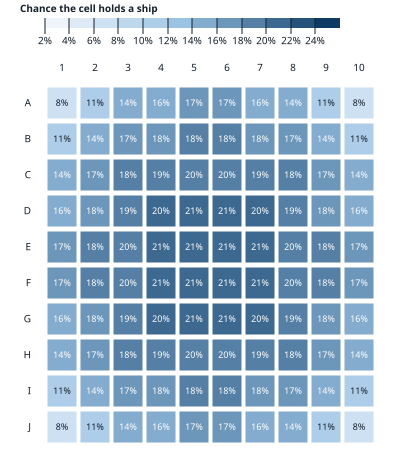
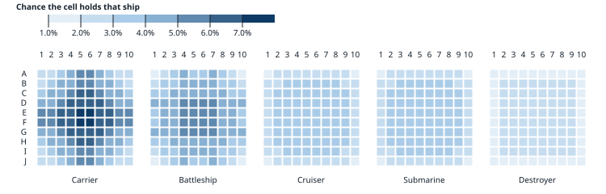
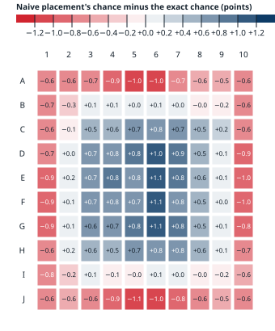
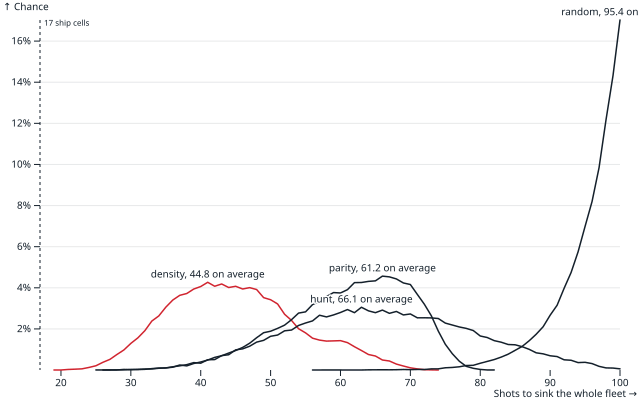
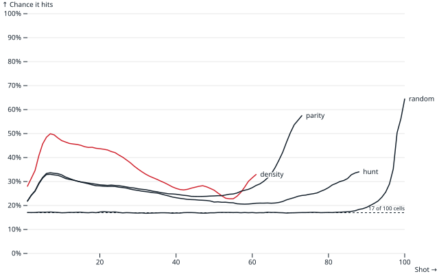
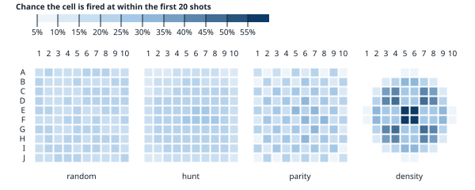
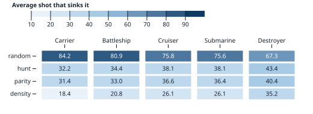
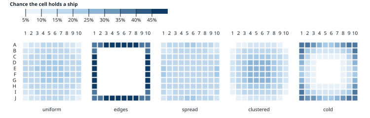
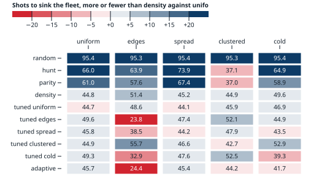
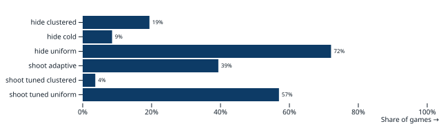

# Battleship

Battleship is the pencil-and-paper game Milton Bradley turned into plastic: each player hides
five ships on a 10×10 grid, then you take turns calling cells ("B7!") until one fleet is gone.
This repo works out where ships tend to be, how to hunt them, and how to hide them, by counting
every legal arrangement exactly and playing a few million games.

The simulator and this analysis were written with Claude Opus 5.5, working in Claude Code.

## The rules modeled

Hasbro's: a 10×10 grid, rows A–J and columns 1–10, and five ships laid in straight lines,
horizontal or vertical, that may touch but not overlap.

| ship | length |
| --- | --- |
| Carrier | 5 |
| Battleship | 4 |
| Cruiser | 3 |
| Submarine | 3 |
| Destroyer | 2 |

That's 17 cells of ship in 100. Each shot is answered hit or miss, and the shot that finishes a
ship is answered with its name ("You sank my battleship!"). The measure throughout is **shots to
sink the whole fleet**: fewer is better for the shooter, more for the hider.

## Where ships are

There are exactly **30,093,975,536** ways to lay out the fleet (`count.ts`). That's too many to
visit one by one, so the count lays the first three ships every way it can and then counts the
last two's non-overlapping pairs from how many of their placements cover each cell. A test
checks the method against brute force on a 5×5 board.

If every arrangement is equally likely, this is the chance each cell holds a ship:

The middle is almost three times as likely as a corner: 21% against 8%. There are more ways
for a ship to cross a central cell than an edge one, and corners can only be reached two ways
per ship. The bigger the ship, the stronger the pull. The carrier is on a center cell 7.5% of
the time and a corner 2.1%; the destroyer barely cares (2.4% against 1.3%).

### Most programs don't place ships at random

The usual way to place a random fleet is to drop each ship somewhere random and, if it overlaps
one already down, try that ship again. That isn't uniform. It places the big ships first on an
empty board, where the middle isn't crowded yet, so it overweights the middle by up to 1.1
points and underweights the rim by about as much. Redrawing the whole fleet on any overlap is
uniform and costs little, since 39% of tries fit. The sampling noise here is about 0.1 points.

## Shooting

Four shooters (`src/shooters.ts`), each played 50,000 times against the same uniformly random
fleets (`games.ts`):

- **random** fires anywhere it hasn't.
- **hunt** fires at random until it hits, then works through the hit's neighbors.
- **parity** is hunt, but hunts only on one color of a checkerboard, since every ship covers
  both colors.
- **density** counts, for every unshot cell, how many placements of the ships still afloat could
  cover it without crossing a miss or a sunk ship, and fires at the most. While there are hits
  no sunk ship accounts for, placements through them count 100× per hit. This is the method
  Jeremy Berry and DataGenetics popularized.

| shooter | average | median | 10th–90th percentile | fewest | most |
| --- | --- | --- | --- | --- | --- |
| random | 95.4 | 97 | 89–100 | 56 | 100 |
| hunt | 66.1 | 66 | 49–84 | 26 | 100 |
| parity | 61.2 | 62 | 49–72 | 25 | 82 |
| density | 44.8 | 44 | 33–58 | 19 | 74 |

Random fire nearly always clears the board: the last ship cell is, on average, the 95th of 100.
Hunting halves that. Parity saves another 5 shots by cutting off the long games: a hunt over half the board
can't run long, so its 90th percentile is 72 against hunt's 84. Density saves 16 more. Averages here are
good to about ±0.1 shots.

Each shot's chance of hitting, among games still going, as a 5-shot moving average:

Random sits at the 17% base rate until the end, when the only cells left are ship. The others
spike after the first hits and then slowly decay as the easy ships go. Density's first shot,
on a center cell, hits 21.5% of the time, and its hit rate peaks at 52% on shot 6.

Where each shooter fires in its first 20 shots: density works out from the four center cells
(each its first shot a quarter of the time) along a checkerboard, and parity's checkerboard
shows. Hunt and random spread evenly.

Density sinks the carrier first, since it's where the heat is, and the destroyer last. Random
sinks the destroyer first only because it has the fewest cells to find.

### Seeking information instead of hits

Density only approximates the odds. Its 100×-per-hit weighting is a rule of thumb, not a
probability. `posterior` (`src/shooters.ts`) does it exactly: it keeps 1,000 fleets drawn
uniformly from every arrangement still consistent with the shots, sinks and the order ships
sank in. It can then fire for hits or for information:

- **exact** fires where the most of those fleets have a ship.
- **info** fires where the answer (miss, hit, or which ship sank) is least predictable, the
  cell with the most entropy. It takes a sure hit only when nothing else is uncertain.

Over 2,000 uniform fleets (`posterior.ts`, about 3 minutes):

| shooter | average shots | first hit |
| --- | --- | --- |
| density | 45.0 | 4.2 |
| exact | 44.8 | 4.3 |
| info | 45.2 | 4.1 |

All three are within ±0.55 shots of each other at 95% confidence, so neither exact odds nor
information-seeking beats the rule of thumb. Seeking information can't help much here:

- Every ship cell has to be shot anyway, so shots to win are 17 plus misses. Knowledge pays only
  when it prevents a later miss.
- While searching, no cell is more than about 21% likely to hold a ship. Below 50%, the cell
  with the least predictable answer is simply the likeliest one, so the two strategies fire at
  the same cells.
- They only part ways after a hit, where info prefers a 50/50 cell to a near-sure hit, and that
  mostly reorders shots that have to be taken anyway.

### Working out the opponent's habit

A tuned shooter crushes a habit it knows about, but it needs to know which habit it's facing.
`adaptive` works it out during the game. For each of the five placers it keeps 50,000 of that
placer's sampled fleets, and after every shot drops the ones the shot rules out. The share of
each placer's fleets still standing measures how likely that habit is. It fires as a density
shooter tuned to a blend of the habits, each weighted by that likelihood. Once fewer than 20 of
any placer's fleets still fit the shots, those shares are noise, so it stops updating them.

A second version, **probing**, deliberately fires to tell the habits apart. While no habit is
95% likely and there's no hit to follow up, it fires where the habits disagree most: the cell
whose hit or miss carries the most information about which habit it is.

Over 2,000 fresh fleets per placer (`adaptive.ts`, about a minute):

| placer | density | tuned to the true placer | adaptive | probing |
| --- | --- | --- | --- | --- |
| uniform | 44.7 | 44.3 | 45.7 | 48.7 |
| edges | 51.4 | 23.9 | 24.7 | 32.9 |
| spread | 45.2 | 44.4 | 45.6 | 50.1 |
| clustered | 45.0 | 42.8 | 44.6 | 46.2 |
| cold | 49.5 | 39.2 | 41.6 | 42.5 |

- **Adaptive gets most of a tuned shooter's gain without being told the habit.** Against edges it
  takes 24.7 shots against 23.9; against cold, 41.6 against 39.2.
- **Not knowing costs about a shot against a fleet that has no habit.** Against uniform and
  spread fleets, adaptive takes about 1 more shot than plain density.
- **Its worst case is 45.7 shots, below the 46.2 the equilibrium promised the hider.** The matrix
  only had shooters that commit to one model before the game starts; one that updates mid-game
  wasn't among the hider's options.
- **Probing costs shots everywhere.** Edge fleets betray themselves within a few misses in the
  middle anyway. Firing to tell habits apart spends shots on cells that are unlikely to be hits,
  and the hits density would have taken find the habit about as fast.

### Going first

In a real game both players shoot in turn, so whoever sinks the other's fleet in fewer shots
wins, and the player who shoots first wins ties. Two density shooters against uniform fleets tie
3.1% of the time, so going first wins **51.5%**. It's 51.1% for hunt, 51.7% for parity and 54.8%
for random, whose games bunch up near 100 shots and tie most.

## Hiding

Five ways to hide a fleet (`src/fleets.ts`), sampled 200,000 times each (`placements.ts`):

- **uniform**: every arrangement equally likely.
- **edges**: every ship along the outer ring.
- **spread**: no two ships touching, not even diagonally.
- **clustered**: each ship touching one already placed.
- **cold**: the coldest of 100 uniform fleets on the exact heat map above, so the fleet sits
  where a density shooter looks last.

And a fifth kind of shooter, **tuned**, that knows your habit. It's density, but weighs each
placement of each ship by how often the hider's placer uses it. "tuned edges" expects a fleet
on the rim.

Every shooter against every placer, colored by how many shots more (blue) or fewer (red) than
density against uniform:

- **Against a density shooter that doesn't know your habit, hug the edges**: 51.4 shots, 6.6
  more than a uniform fleet. Cold gets 4.7 more. Both hide where density looks last; its first
  hit takes 15.8 shots against an edge fleet and 10.0 against a cold one, against 4.2 for uniform.
- **If they know, edges is the worst choice there is**: 23.9 shots, not far above the 17
  cells of ship. Cold falls to 39.2. A habit that beats the standard shooter is exactly what a
  shooter learns to exploit.
- **Against hunt, spread out; against density, it doesn't matter.** Hunt chews through a
  cluster (37.2 shots), since every neighbor of a hit is likely another ship, and wastes shots
  around spread fleets (73.9). Density assumes neither, so both are within half a shot of
  uniform against it.
- **A uniform fleet can't be exploited much.** Its worst case is 44.6 shots, against the
  shooter tuned for it, only 0.2 fewer than plain density. That's what being uniform buys: no
  habit to learn.

### The best mix

If both players know each other's options, it's a zero-sum game: the hider picks a placer to
maximize shots, the shooter picks a shooter to minimize them. Solving it (`equilibrium.ts`, by
fictitious play over the matrix above, without random) gives:

The hider should mostly cluster (58%) and sometimes go cold (38%), which holds the shooter to
**46.2 shots**, 1.4 more than a uniform fleet manages against density. The shooter mixes density
tuned for uniform and tuned for spread, with a little parity, whose habit of working every
neighbor of a hit punishes clusters. The gain is small, and only over the strategies tried here.
A density shooter that also checks around each sunk ship would probably punish clustering
harder; that's untested.

## Cheat sheet

`cheat/` is a page to play a real game with: tap the cell you fired at and say miss, hit, or which
ship sank. It shades the board by the algorithm you pick and lists every algorithm's next shot.
It also shows adaptive's current guess of which habit your opponent uses. `pnpm cheat` serves it
with Vite, and `pnpm build` builds it into `cheat/dist/`.

## Reproducing

Node 24 runs the TypeScript directly. `pnpm install`, then `make` (about a minute). Raw data is
in `results/` as Parquet, a row per arrangement count, sampled fleet, game or shot, and
`charts.ts` draws `charts/` from it with Observable Plot. `node --test` runs the tests.
`posterior.ts` and `adaptive.ts` print their tables and aren't part of `make`.
