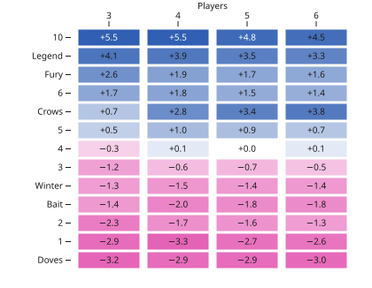
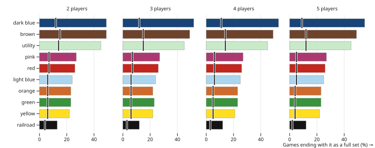

# Monopoly Deal

Monopoly Deal is Hasbro's card game of Monopoly: 106 cards, no board, no dice, and games that
last fifteen minutes. You bank money, lay down properties and charge rent like the board game,
but most of the cards are actions that take from other players: Sly Deal steals a property, Deal
Breaker steals a whole set, and Just Say No stops either. The first player with three full sets
wins.

This repo is a simulator of the game. It plays millions of games by the rules, so it can answer
the questions that come up at the table: whether going first matters, which cards are worth
keeping, which sets to chase, whether to build houses, and when to lay your properties down.

The answers come from the model, not from real tables. It follows the rule sheet of the 2014 US
edition (B0965), and the rules the sheet leaves open are measured both ways (see "Rules
questions"). It hasn't been checked against logged real games yet.

The simulator and this analysis were written with Claude, working in Claude Code throughout.

## A quick refresher

Everyone is dealt 5 cards. Each turn you draw 2 (5 if your hand is empty) and play up to 3:

- **Money and action cards into your bank.** Every action card can be banked as money instead.
- **Properties onto the table**, into sets by color. A set is 2 to 4 cards; dark blue, brown and
  utility take 2, railroads 4, the rest 3. Wilds count as one of two colors, or the two
  multicolored ones as any, and can be moved between sets on your own turn.
- **Actions.** Rent charges for one of your colors: a two-color Rent card charges everyone, the
  any-color one charges one player, and Double the Rent doubles it. Debt Collector takes $5M from
  one player and It's My Birthday $2M from everyone. Sly Deal takes a property, Forced Deal swaps
  one, and Deal Breaker takes a full set. Pass Go draws 2. A House or Hotel adds rent to a full
  set.

You pay what you owe from your bank and your properties, your choice, and get no change. If you
can't pay it all, you pay everything you have. Just Say No cancels any action against you, and
can itself be cancelled by another. You end your turn with at most 7 cards in hand. Three full
sets of different colors win. When the draw pile runs out, the cards played are shuffled into a
new one.

## How to read the numbers

**Share of wins** is the measure throughout. A full set doesn't count unless it's your third, and
money in the bank isn't worth anything at the end, so every other measure is a step toward a
win at best.

**A fair share** is 100% ÷ players: 50% at 2 players, 20% at 5.

**Points** are percentage points of a share of wins, never money or cards: winning 21.7% of games
instead of 20.0% is +1.7 points.

**One hand-written player** plays every seat, or every seat but one: `defaultPolicy` in
`src/game.ts`. It tries a list of rules in order and makes the first move one allows: complete a
set, Deal Breaker, Sly Deal, charge rent, Debt Collector, Birthday, Forced Deal, bank, and only
then lay down properties. Every table depends on how well it plays, and "Playing well" shows how
that list was found and how far it is from the best play we know.

**Noise.** Most tables are 100,000 games per cell, so a share of wins is good to about ±0.3
points, two standard errors. Games are played from seeded deals, so a comparison plays both sides
on the same deals.

**Stalled** games are ones with no winner after 1,000 turns. They count as a win for no one.

Node 24 runs everything with no dependencies, and each section names the script behind it:

```bash
node scripts/sim.ts --n 100000 --players 4
```

The charts are drawn from this README's own tables, so they stay in step with them. After
`pnpm install`, `node scripts/charts.ts` redraws `charts/`.

## Going first

*From `node scripts/sim.ts`*, with the default player in every seat:

| players | first | second | third | fourth | fifth | turns per game | draw pile reshuffled |
| --- | --- | --- | --- | --- | --- | --- | --- |
| 2 | 56.8% | 43.2% | | | | 16.3 | 0.0% |
| 3 | 36.6% | 32.0% | 31.3% | | | 21.0 | 0.1% |
| 4 | 27.4% | 24.9% | 24.2% | 23.6% | | 25.2 | 9.4% |
| 5 | 21.7% | 20.4% | 19.8% | 19.0% | 19.2% | 28.5 | 35.6% |


**Going first is worth 13.6 points at 2 players.** That's 31% more wins than the second player.
At 5 players the edge is 1.7 points over a fair share. The first player starts drawing and
playing a turn ahead, and in a 16-turn 2-player game, that turn matters more.

**A game lasts about 8 rounds at 2 players and about 6 at 5.** A round is a turn for each player.

**The draw pile runs out in a third of 5-player games.** It holds 106 − 5 × 5 = 81 cards after the
deal. It almost never runs out at 2 or 3 players.

## Which strategy wins

*From `node scripts/strategies.ts`*, which seats one player of each strategy in
`src/strategies.ts` against the default player in every other seat, rotating seats. Playouts are
slow, so they play 512 games per cell, which is good to about ±4 points.

| strategy | 2 players (fair 50.0%) | 3 players (fair 33.3%) | 4 players (fair 25.0%) | 5 players (fair 20.0%) |
| --- | --- | --- | --- | --- |
| default | 49.9% | 33.2% | 25.0% | 20.0% |
| builder | 40.1% | 22.7% | 16.2% | 13.0% |
| banker | 49.9% | 33.4% | 25.5% | 20.2% |
| pacifist | 11.9% | 2.3% | 0.4% | 0.0% |
| random | 7.4% | 2.5% | 1.2% | 0.6% |
| playouts | 46.1% | 41.0% | 34.6% | 38.1% |


**Builder** plays the way the default player first did. It lays down properties as soon as it
draws them, builds houses and hotels, and only then charges rent. It wins 10 points less than the
default at 2 players, and a third fewer games at 5. "Playing well" breaks that gap down.

**Banker** banks $10M before anything else. That's now about the same as the default, which
already banks its money before laying properties down.

**Pacifist** never takes from anyone and banks every action card. It almost never wins: this is a
game of taking.

**Random** plays a legal move at random. It's the floor.

**Playouts** plays out every legal move on 80 deals before each play and makes the move that wins
most. For each deal it reshuffles the cards it can't see, the other hands and the draw pile, so it
doesn't peek. At 3 to 5 players it wins 8 to 18 points more than the default, so there is still a
lot to find. At 2 players it's no better, within its ±4 points.

## Playing well

*From `node scripts/variants.ts`.* `scripts/decisions.ts` plays out every legal move at each of
the default player's decisions and lists the kinds of decision where playouts, rechecked on fresh
deals, clearly beat it. Each pattern became a variant, played head to head like the strategies
above: one player plays the variant, the default plays every other seat, and the table gives the
variant's share of wins.
`scripts/order.ts` also searched the order of the rules, moving one at a time. Rows marked
"(previous)" are what the default used to do, so each costs the default about as much as the
change from it gained.

| variant | 2 players (fair 50.0%) | 5 players (fair 20.0%) |
| --- | --- | --- |
| the builder | 40.1% | 13.0% |
| lay down properties before charging (previous) | 42.0% | 14.4% |
| lay down properties before banking (previous) | 44.4% | 16.1% |
| build houses and hotels, never bank them (previous) | 46.5% | 17.9% |
| Deal Breaker refuses when the best set is a color it has (previous) | 49.5% | 19.2% |
| any-color Rent on the richest (previous) | 49.9% | 18.3% |
| Debt Collector on the richest (previous) | 49.9% | 19.2% |
| bank all money before laying down properties (previous) | 48.9% | 19.9% |
| build, else bank them | 49.7% | 19.8% |
| Pass Go only as the last play | 46.6% | 17.3% |
| bank Pass Go | 34.6% | 12.6% |
| Deal Breaker before Pass Go | 49.9% | 20.2% |
| Debt Collector on the most money banked | 49.9% | 19.0% |
| any-color Rent on the most money banked | 49.9% | 18.1% |
| lay down wilds before charging | 49.0% | 19.4% |
| lay down properties once $5M is banked | 49.5% | 19.1% |
| lay down properties once $15M is banked | 49.8% | 20.3% |


**Charge before you lay properties down, and bank before that too.** This is the biggest lesson,
worth 8 points at 2 players and 5 at 5. A property laid down can be taken by Sly Deal, Forced Deal
or as payment. One held in hand can't, and it can go down later in a single turn. The default
still lays a property down right away when it completes a set.

**Don't build.** Banking a house ($3M) or hotel ($4M) as money beats putting it on a set. Never
banking them costs 3.4 points at 2 players. Building when you can and banking otherwise is no
better than never building. A house adds $3M to one rent card's charge, but the play spent placing
it could have charged rent itself. A set with a house is also the first thing a Deal Breaker
takes.

**Aim one-player charges at the leader**, the player with the most full sets. The any-color Rent
and Debt Collector used to go to whoever had the most to pay with. Aiming them at the leader is
worth 1.7 points at 5 players. At 2 players there's only one target.

**Don't save Pass Go.** Playing it first, while plays are left to use what it draws, beats holding
it for the last play by 3 points at 2 players. Banking it costs 15.

**Bank about $10M, then lay properties down before banking more.** This beats banking everything
first by 1 point at 2 players, and is even at 5. $5M is too little, and $15M is about the same as
$10M.

**Deal Breaker had a bug.** It sorted sets of a color it already had first, then refused them, so
it often skipped a better target. Fixing it was worth 1 point at 5 players.

Tried and rejected, besides the alternatives in the table (20,000 games each, at 2 and 5
players, against 50.1% and 19.6% for the default in that seat on the same deals):

- Choosing which property to lay down first: by the most progress toward a set, the least, wilds
  first, wilds last, the cheapest, the dearest, the highest rent or the smallest set. All were
  within noise of taking the first one in hand, the one held longest, or worse (wilds first: 18.6% at 5 players).
- Laying down a property of a color a Rent card in hand charges, then charging: 49.7% and 18.8%.
- Laying down properties before Debt Collector and Birthday: 46.2% and 16.5%.

**What's left of the placement gap has no pattern.** At 5 players, `decisions.ts` finds playouts
laying a property down before charging rent, Debt Collector or Birthday in some spots, and the
default's choice of rent first or ending the turn winning in others. No rule that splits them
beat the default.

### How good could the choices be?

Playouts still beat the default by 8 to 18 points at 3 to 5 players. What's left, from
`decisions.ts` at 5 players:

- which color and target to charge with the any-color Rent;
- who to Forced Deal.

Untouched so far: when to hold Just Say No, and what to pay with.

## What each card is worth

*From `node scripts/cards.ts`*, which deals each game twice: once as dealt, and once with one copy
of a card moved from the draw pile into one player's opening hand. The difference in that player's
wins is the card's value, in points. The noise is about ±0.5 points, and $M is what the card is
worth as money. Sorted by 4 players:

| card | $M | 2 players | 3 players | 4 players | 5 players |
| --- | --- | --- | --- | --- | --- |
| Deal Breaker | 5 | +28.7 | +26.3 | +20.2 | +14.7 |
| Rent, dark blue/green | 1 | +3.2 | +5.0 | +7.6 | +8.2 |
| Just Say No | 4 | +12.7 | +10.0 | +6.3 | +4.2 |
| Rent, red/yellow | 1 | +2.3 | +4.0 | +5.6 | +6.1 |
| Property Wild, any color | 0 | +10.1 | +7.9 | +5.4 | +4.8 |
| It's My Birthday | 2 | +4.5 | +4.8 | +5.0 | +4.6 |
| Rent, light blue/brown | 1 | +0.3 | +2.5 | +4.3 | +4.4 |
| Property Wild, dark blue/green | 4 | +6.8 | +5.4 | +4.0 | +2.2 |
| Rent, railroad/utility | 1 | −0.2 | +2.8 | +3.8 | +4.8 |
| Rent, pink/orange | 1 | +0.7 | +3.0 | +3.7 | +4.7 |
| Debt Collector | 3 | +9.3 | +5.1 | +3.6 | +2.2 |
| Rent, any color | 3 | +4.5 | +5.0 | +3.5 | +2.8 |
| dark blue | 4 | +5.5 | +4.5 | +3.0 | +1.8 |
| Property Wild, light blue/brown | 1 | +4.8 | +4.0 | +2.9 | +1.9 |
| Property Wild, railroad/utility | 2 | +4.6 | +3.6 | +2.9 | +1.6 |
| Property Wild, red/yellow | 3 | +3.9 | +3.3 | +2.6 | +1.5 |
| Pass Go | 1 | +5.5 | +4.4 | +2.2 | +1.2 |
| $4M | 4 | +1.5 | +2.3 | +2.0 | +0.5 |
| Property Wild, pink/orange | 2 | +3.6 | +2.8 | +1.8 | +0.8 |
| brown | 1 | +3.1 | +2.1 | +1.8 | +1.3 |
| $5M | 5 | +2.1 | +2.4 | +1.7 | +1.1 |
| Property Wild, green/railroad | 4 | +3.5 | +2.4 | +1.6 | +0.8 |
| utility | 2 | +3.6 | +2.7 | +1.5 | +1.2 |
| $2M | 2 | +1.0 | +1.5 | +1.5 | +0.5 |
| $3M | 3 | +0.8 | +1.1 | +1.4 | +0.8 |
| Hotel | 4 | +1.2 | +1.7 | +1.4 | +0.7 |
| Sly Deal | 3 | +7.5 | +3.5 | +1.3 | −0.3 |
| yellow | 3 | +2.5 | +1.7 | +1.3 | +0.4 |
| Property Wild, light blue/railroad | 4 | +2.6 | +2.6 | +1.2 | +0.8 |
| House | 3 | +1.6 | +1.7 | +1.1 | +1.0 |
| orange | 2 | +1.9 | +1.2 | +1.0 | +0.0 |
| $1M | 1 | −0.2 | +0.7 | +0.8 | −0.0 |
| pink | 2 | +1.7 | +0.7 | +0.6 | +0.1 |
| red | 3 | +2.3 | +1.5 | +0.5 | +0.2 |
| Double the Rent | 1 | +0.8 | +0.1 | +0.5 | +0.8 |
| green | 4 | +2.2 | +1.4 | +0.4 | +0.2 |
| Forced Deal | 3 | +3.4 | +0.9 | +0.3 | −0.8 |
| railroad | 2 | +1.0 | +0.7 | +0.2 | −0.2 |
| $10M | 10 | +1.8 | +1.0 | +0.2 | −0.2 |
| light blue | 1 | +1.7 | +0.8 | −0.4 | −0.3 |



**Deal Breaker is worth the most by far.** With it, a 2-player game goes from a coin flip to 79%
for the holder. It's a third of a win, taken from someone else.

**Two-color Rent cards gain value with more players**, from 0 to +3 at 2 players to +4 to +8 at 5.
Each one charges every other player, so it collects more the more players there are. The one for
the most expensive colors, dark blue and green, is the second most valuable card at 4 and 5
players. Yet each is worth just $1M as money.

**Cards that hit one player lose value with more players.** Just Say No, Debt Collector and Sly
Deal are each worth far more at 2 players, where the one player they hit is the only opponent.

**Money is worth little**, never more than 2.4 points, and $10M is worth barely more than $1M. One
more card of money mostly sits in the bank as insurance against rent.

**The two multicolored Property Wilds are worth nothing as money, but they're among the most
valuable cards** at 2 and 3 players. They fit any set.

**Of the properties, dark blue, brown and utility are worth most.** They're the 2-card sets. Light
blue, railroad and green are worth least.

A card worth less than nothing, like Forced Deal and Sly Deal at 5 players, shows where the
default player misplays it, not that you'd be better off without it.

## Which colors to chase

*From `node scripts/colors.ts`*, which counts, at the end of each game, the colors of the winner's
full sets and of the losers'. A winner has exactly 3 sets, so the shares in a column add up to
300%. The winner's share comes first, then in parentheses how often a loser holds that color as a
full set at the end.

| color | cards in a set | 2 players | 3 players | 4 players | 5 players |
| --- | --- | --- | --- | --- | --- |
| dark blue | 2 | 49% (12%) | 52% (13%) | 54% (12%) | 57% (10%) |
| brown | 2 | 49% (15%) | 49% (16%) | 49% (15%) | 49% (13%) |
| utility | 2 | 45% (14%) | 45% (15%) | 45% (15%) | 44% (13%) |
| pink | 3 | 27% (7%) | 27% (7%) | 27% (7%) | 27% (6%) |
| red | 3 | 26% (7%) | 26% (7%) | 26% (7%) | 26% (5%) |
| light blue | 3 | 24% (6%) | 24% (7%) | 25% (6%) | 26% (5%) |
| orange | 3 | 23% (6%) | 22% (6%) | 22% (6%) | 23% (5%) |
| green | 3 | 23% (6%) | 23% (6%) | 23% (6%) | 23% (5%) |
| yellow | 3 | 22% (6%) | 22% (6%) | 22% (5%) | 22% (4%) |
| railroad | 4 | 13% (4%) | 12% (3%) | 12% (3%) | 12% (2%) |



**Each 2-card set, dark blue, brown and utility, is in about half of all wins.** That's about twice
as often as any 3-card set.

**Railroads, the one 4-card set, are in only one win in eight.**

**Dark blue rises to 57% at 5 players.** It's a 2-card set and charges the highest rent, 8. So
it's the set most worth finishing, and the one most worth taking with a Deal Breaker.

So: chase 2-card sets, especially dark blue, and leave railroads for last. The default player only
places what it draws, so these shares follow from how easy each set is to finish, not from any
plan.

## Rules questions

The rule sheet leaves some rules open, and Hasbro publishes no FAQ to settle them. Fan sites
disagree, and they rarely cite a source. So the engine reads each one way (see `CLAUDE.md`), and
*`node scripts/sensitivity.ts`* plays 100,000 games each way from the same seeds, for each player
count. Each row names the other reading. Each cell gives the share of games whose winner changes,
then the change in the first player's share of wins in points, then the change in turns per game,
then any change in the number of stalled games:

| reading | 2 players | 3 players | 4 players | 5 players |
| --- | --- | --- | --- | --- |
| One Double the Rent per Rent card | 0.2%: +0.0, +0.0 | 0.4%: +0.0, +0.0 | 0.6%: +0.0, +0.0 | 0.7%: +0.0, +0.0 |
| Just Say No on your turn is a play | 1.2%: +0.0, +0.0 | 3.5%: +0.0, +0.1 | 5.7%: −0.1, +0.1 | 8.6%: +0.0, +0.1 |
| A broken set's house and hotel go to the bank | 0.0%: +0.0, +0.0 | 0.0%: +0.0, +0.0 | 0.0%: +0.0, +0.0 | 0.0%: +0.0, +0.0 |
| Deal Breaker leaves the house and hotel | 0.0%: +0.0, +0.0 | 0.0%: +0.0, +0.0 | 0.0%: +0.0, +0.0 | 0.0%: +0.0, +0.0 |
| A set of only multicolored wilds is full | 0.3%: +0.0, +0.0 | 1.0%: +0.0, +0.0 | 2.2%: +0.0, +0.0 | 3.5%: −0.1, +0.0 |
| No reshuffle | 0.0%: +0.0, +0.0 | 0.1%: +0.0, +0.5, +49 stalled | 6.8%: −1.3, +48.0, +4970 stalled | 28.8%: −4.0, +220.9, +22902 stalled |

Once a reading changes one play, the rest of the game goes differently, and the winner then
changes about as often as in an unrelated game. So the first number tracks how often the rule
comes up at all.

**None of the readings favors a seat.** That's expected when every player plays the same way. The
one exception is the reshuffle, which changes how long games last.

**Just Say No as a play comes up most,** in up to 9% of games at 5 players. It only bites when you
counter a No on your own turn after using all three plays.

**The two readings about houses and hotels never come up,** because the default player never
builds. They'd matter only for a player that does.

**Double the Rent stacking and wild-only sets come up in 0–4% of games.** There are only 2 Double
the Rents and 2 multicolored wilds in the deck.

**No reshuffle breaks 4- and 5-player games.** At 5 players the draw pile runs out in a third of
games. Without a reshuffle, a quarter of all games end with no winner after 1,000 turns. A
no-reshuffle house rule needs its own ending.

## Next

`TODO.md` has what's left: closing more of the gap to playouts, and logging real games to compare
with the model.
