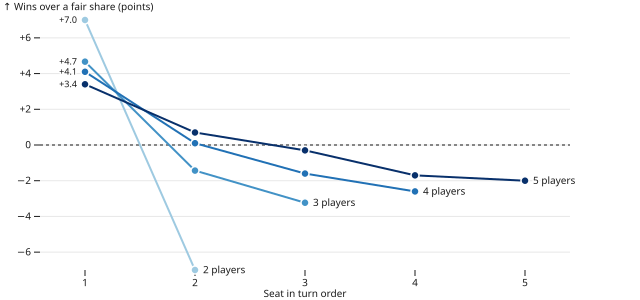
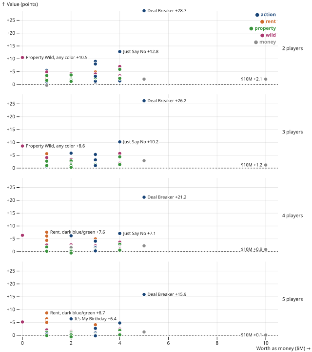
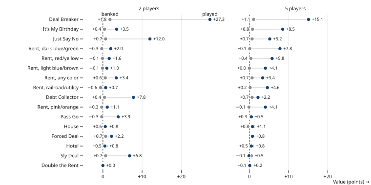
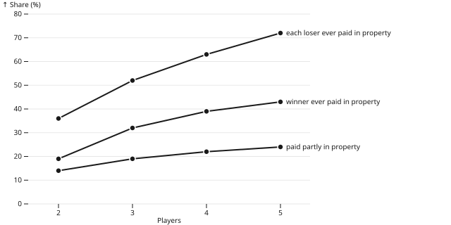
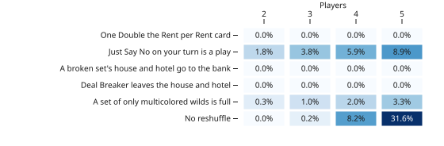

# Monopoly Deal

Monopoly Deal is Hasbro's card game of Monopoly: 106 cards, no board, no dice, and games that
last fifteen minutes. You bank money, lay down properties and charge rent like the board game,
but most of the cards are actions that take from other players: Sly Deal steals a property, Deal
Breaker steals a whole set, and Just Say No stops either. The first player with three full sets
wins.

This repo is a simulator of the game. It plays millions of games by the rules, so it can answer
the questions that come up at the table: whether going first matters, which cards are worth
keeping, which sets to chase, whether to build houses, and when to lay your properties down.

The answers come from the model, not from real tables. It follows the rule sheet of the 2014 US
edition (B0965), and the rules the sheet leaves open are measured both ways (see "Rules
questions"). It hasn't been checked against logged real games yet.

The simulator and this analysis were written with Claude, working in Claude Code throughout.

## A quick refresher

Everyone is dealt 5 cards. Each turn you draw 2 (5 if your hand is empty) and play up to 3:

- **Money and action cards into your bank.** Every action card can be banked as money instead.
- **Properties onto the table**, into sets by color. A set is 2 to 4 cards; dark blue, brown and
  utility take 2, railroads 4, the rest 3. Wilds count as one of two colors, or the two
  multicolored ones as any, and can be moved between sets on your own turn.
- **Actions.** Rent charges for one of your colors: a two-color Rent card charges everyone, the
  any-color one charges one player, and Double the Rent doubles it. Debt Collector takes $5M from
  one player and It's My Birthday $2M from everyone. Sly Deal takes a property, Forced Deal swaps
  one, and Deal Breaker takes a full set. Pass Go draws 2. A House or Hotel adds rent to a full
  set.

You pay what you owe from your bank and your properties, your choice, and get no change. If you
can't pay it all, you pay everything you have. Just Say No cancels any action against you, and
can itself be cancelled by another. You end your turn with at most 7 cards in hand. Three full
sets of different colors win. The sheet doesn't say what happens when the draw pile runs out;
here the cards played are shuffled into a new one (see "Rules questions").

## How to read the numbers

**Share of wins** is the measure throughout. A full set doesn't count unless it's your third, and
money in the bank isn't worth anything at the end, so every other measure is a step toward a
win at best.

**A fair share** is 100% ÷ players: 50% at 2 players, 20% at 5.

**Points** are percentage points of a share of wins, never money or cards: winning 21.7% of games
instead of 20.0% is +1.7 points.

**One hand-written player** plays every seat, or every seat but one: `defaultPolicy` in
`src/game.ts`. It tries a list of rules in order and makes the first move one allows: complete a
set, Deal Breaker, Sly Deal, charge rent, Debt Collector, Birthday, Forced Deal, bank, and only
then lay down properties. Every table depends on how well it plays, and "Playing well" shows how
that list was found and how far it is from the best play we know.

**Noise.** Most tables are 100,000 games per cell, so a share of wins is good to about ±0.3
points, two standard errors. Games are played from seeded deals, so a comparison plays both sides
on the same deals.

**Stalled** games are ones with no winner after 200 turns. They count as a win for no one.
"Stalled games" says where they come from.

Node 24 runs everything with no dependencies, and each section names the script behind it:

```bash
node scripts/sim.ts --n 100000 --players 4
```

The charts are drawn from this README's own tables, so they stay in step with them. After
`pnpm install`, `node scripts/charts.ts` redraws `charts/`.

## Going first

*From `node scripts/sim.ts`*, with the default player in every seat:



| players | first | second | third | fourth | fifth | turns per game | draw pile reshuffled |
| --- | --- | --- | --- | --- | --- | --- | --- |
| 2 | 57.0% | 43.0% | | | | 16.4 | 0.0% |
| 3 | 37.4% | 31.9% | 30.6% | | | 21.2 | 0.2% |
| 4 | 27.7% | 24.8% | 24.2% | 23.3% | | 25.3 | 10.0% |
| 5 | 21.7% | 20.1% | 19.6% | 19.1% | 19.5% | 28.7 | 37.0% |

**Going first is worth 14.0 points at 2 players.** That's 33% more wins than the second player.
At 5 players the edge is 1.7 points over a fair share. The first player starts drawing and
playing a turn ahead, and in a 16-turn 2-player game, that turn matters more.

**A game lasts about 8 rounds at 2 players and 5 to 6 at 5.** A round is a turn for each player.

**The draw pile runs out in more than a third of 5-player games.** It holds 106 − 5 × 5 = 81
cards after the deal. It almost never runs out at 2 or 3 players.

## Which strategy wins

*From `node scripts/strategies.ts`*, which seats one player of each strategy in
`src/strategies.ts` against the default player in every other seat, rotating seats. Playouts are
slow, so they play 10,000 games per cell, which is good to about ±1 point.


| strategy | 2 players (fair 50.0%) | 3 players (fair 33.3%) | 4 players (fair 25.0%) | 5 players (fair 20.0%) |
| --- | --- | --- | --- | --- |
| default | 49.7% | 33.2% | 24.9% | 20.0% |
| builder | 39.0% | 21.8% | 15.1% | 12.2% |
| banker | 49.8% | 33.4% | 25.2% | 20.1% |
| pacifist | 11.0% | 2.1% | 0.3% (11 stalled) | 0.0% (48 stalled) |
| random | 5.7% | 2.0% | 0.7% | 0.4% |
| playouts | 59.8% | 50.4% | 45.6% | 41.9% |
| quick playouts | 55.6% | 42.8% | 38.7% | 36.9% |

**Builder** plays the way the default player first did. It lays down properties as soon as it
draws them, builds houses and hotels, and only then charges rent. It wins 11 points less than the
default at 2 players, and more than a third fewer games at 5. "Playing well" breaks that gap down.

**Banker** banks $10M before anything else. That's now about the same as the default, which
already banks its money before laying properties down.

**Pacifist** never takes from anyone and banks every action card. It almost never wins: this is a
game of taking.

**Random** plays a legal move at random. It's the floor.

**Playouts** has no rules of its own. It tries each option by imagining how it turns out, the way
a chess player thinks a few moves ahead, except by trial instead of reasoning. Before every play
it lists everything it could do: each card it could bank, lay down or play, at each target, or
ending its turn. For each option it plays the game forward many times on a copy of the table,
with the default player making every choice from there, and it picks the option that came out
ahead most often.

It can't see the other hands or the draw pile, so each time it imagines them by shuffling the
cards it can't see and dealing them out again. It doesn't peek: it only knows what a player at
the table would. Different shuffles turn out differently, so it tries each option on 8 shuffles
at a time, drops any option that's clearly behind, and keeps going with the rest, up to 80
shuffles. This is a Monte Carlo search; the name comes from the casino, since it learns by
rolling the dice.

It doesn't play each imagined game to the end. It stops two rounds ahead, when everyone has had
two more turns, and judges the table instead: a formula fitted to thousands of games that turns
full sets, progress toward more, money and the cards in hand into each player's chance to win
(`scripts/chance.ts`). That's faster, and it plays better. Playing every imagined game to the end,
it won 50.3%, 39.5%, 36.4% and 33.7%, probably because the further ahead it looks, the more each
result depends on the draw and on the default player's weaker choices than on the option tried. It wins 10 to 22 points more than the default, so there is still a lot
to find.

**Quick playouts** is the same with less imagining: 16 shuffles an option, one round ahead.
It's about 5 times faster (the row took 4 minutes on 20 cores, against 21) and still wins 6 to 17
points more than the default: a strong opponent that's cheap enough to play against.

**Skill counts for more at big tables.** Against the default, playouts win 1.20 fair shares at
2 players and 2.10 at 5. At 2 players the weaker player still wins nearly 4 games in 10; at 5,
the four default players together win only 58%.

## Playing well

*From `node scripts/variants.ts`.* `scripts/decisions.ts` plays out every legal move at each of
the default player's decisions and lists the kinds of decision where playouts, rechecked on fresh
deals, clearly beat it. Each pattern became a variant, played head to head like the strategies
above: one player plays the variant, the default plays every other seat, and the table gives the
variant's share of wins.
`scripts/order.ts` also searched the order of the rules, moving one at a time. Rows marked
"(previous)" are what the default used to do, so each costs the default about as much as the
change from it gained.


| variant | 2 players (fair 50.0%) | 5 players (fair 20.0%) |
| --- | --- | --- |
| the builder | 39.0% | 12.2% |
| lay down properties before charging (previous) | 41.0% | 13.4% |
| lay down properties before banking (previous) | 43.0% | 14.9% |
| build houses and hotels, never bank them (previous) | 45.8% | 17.8% |
| build, else bank them | 49.5% | 19.7% |
| Pass Go only as the last play | 45.5% | 16.8% |
| bank Pass Go | 37.9% | 13.1% |
| Deal Breaker before Pass Go | 49.7% | 20.2% |
| Sly Deal before Pass Go | 49.8% | 20.1% |
| Debt Collector on the richest (previous) | 49.7% | 18.2% |
| any-color Rent on the richest (previous) | 49.7% | 16.9% |
| bank all money before laying down properties (previous) | 48.2% | 19.4% |
| Debt Collector on the most money banked | 49.7% | 18.0% |
| any-color Rent on the most money banked | 49.7% | 16.7% |
| lay down wilds before charging | 48.9% | 18.9% |
| any-color Rent and Debt Collector on the leader (previous) | 49.7% | 17.4% |
| any-color Rent and Debt Collector on the most paid in property | 49.7% | 20.0% |
| any-color Rent on the least banked | 49.7% | 19.6% |
| charge rent worth $2M or more at 2 players (previous) | 47.5% | 20.0% |
| play Forced Deal in the first round (previous) | 49.7% | 19.6% |
| hold Double the Rent (previous) | 49.3% | 20.0% |
| bank Rent cards for colors we have none of | 49.4% | 14.0% |
| Deal Breaker on the leader first | 49.7% | 20.2% |
| hold the card that completes a set unless it wins | 34.4% | 17.4% |
| Just Say No only against Deal Breaker | 47.8% | 19.1% |
| keep one Just Say No for a Deal Breaker | 48.4% | 19.3% |
| keep two Just Say Nos for a Deal Breaker | 47.8% | 19.1% |
| lay down properties once $5M is banked | 49.4% | 18.6% |
| lay down properties once $15M is banked | 49.5% | 20.2% |

**Charge before you lay properties down, and bank before that too.** This is the biggest lesson,
worth 9 points at 2 players and 7 at 5. A property laid down can be taken by Sly Deal, Forced Deal
or as payment. One held in hand can't, and it can go down later in a single turn. The default
still lays a property down right away when it completes a set.

**Don't build.** Banking a house ($3M) or hotel ($4M) as money beats putting it on a set. Never
banking them costs 3.9 points at 2 players. Building when you can and banking otherwise is no
better than never building. A house adds $3M to one rent card's charge, but the play spent placing
it could have charged rent itself. A set with a house is also the first thing a Deal Breaker
takes.

**Charge one player who has to pay in property.** The any-color Rent and Debt Collector hit one
player. Aim them at someone whose bank can't cover the charge but whose table can, since the
properties they pay with come to you. Among those, pick whoever pays the most, then the leader,
the player with the most full sets. Aiming both at the leader instead costs 2.6 points at 5
players, and aiming them at whoever has the most to pay with costs more. At 2 players there's
only one target. At 5 players, playouts at each any-color Rent found this rule gaining 8 points
each time it chose differently from aiming at the leader, more than any other rule tried: the
least banked, the richest, the next or previous seat, the most or fewest cards in hand, and others.

**Don't save Pass Go.** Playing it first, while plays are left to use what it draws, beats holding
it for the last play by 4 points at 2 players. Banking it costs 12.

**Bank about $10M, then lay properties down before banking more.** This beats banking everything
first by 1.5 points at 2 players and 0.6 at 5. $5M is too little, and $15M is about the same as
$10M.

**Charge even $1M at 2 players.** The default used to skip a rent that collected less than $2M.
At 2 players, charging it anyway is worth 2.2 points; at 3 and 4 it costs a little, so the rule
stays there.

**Bank a Forced Deal in the first round at 3+ players, and Double the Rent when there's no rent
to double.** Early on there's little worth swapping, and the money protects the properties you
lay down later. Each gains 0.3 to 0.5 points where it applies (400,000 games). Banking Rent
cards for colors you have none of loses badly: 6 points at 5 players, where those cards charge
everyone.

**Two pieces of table advice lose.** Players online say to hold the property that completes a
set, so a Deal Breaker can't take the set, and to keep a Just Say No for a Deal Breaker instead
of spending it on rent. Holding the card costs 15 points at 2 players and 3 at 5: a set in hand
charges no rent and counts toward no win. Keeping a Just Say No, even only while holding two,
costs 0.7 to 1.9 points at every player count (3 and 4 players: 31.4% to 31.9% and 23.5% to
23.8%, against 33.2% and 24.9%). What you lose by paying now is worth more than the Deal Breaker it might stop later.

Tried and rejected, besides the alternatives in the table (at 2 and 5 players, against 49.7% and
20.0% for the default):

- Choosing which property to lay down first: by the most progress toward a set, the least, wilds
  first, the cheapest, the dearest, the highest rent or the smallest set. All were within noise
  of taking the first one in hand, the one held longest, or worse (wilds first: 19.2% at 5
  players). The most progress first with wilds last gains 0.4 points at 2 players, but 0.2 at 3
  and −0.2 at 5 (400,000 games each).
- Laying down a property of a color a Rent card in hand charges, then charging: 49.5% and 19.5%.
- Laying down properties before Debt Collector and Birthday: 45.7% and 15.8%.

**What's left of the placement gap has no pattern.** At 5 players, `decisions.ts` finds playouts
laying a property down before charging rent, Debt Collector or Birthday in some spots, and the
default's choice of rent first or ending the turn winning in others. No rule that splits them
beat the default.

### How good could the choices be?

Playouts still beat the default by 10 to 22 points. What's left at 5 players, found with
playouts that play each deal to the end:

- **Forced Deal.** At 5 players, the best Forced Deal by playouts, rechecked on fresh deals, beats
  the default's by 4.6 points each time they differ, or 1.6 points a game. Most of that is taking
  a different card, often from a different player. But no rule for it beat the default: taking
  from the leader, the dearest card, wilds first, what the victim is closest to finishing, giving
  the cheapest card or what helps the victim least, giving wilds too, swapping on a tie, on any
  swap or only on a clear gain, or playing it before rent. Each was scored by playouts at the same
  decisions. None beat the default beyond the noise, and some, like taking the dearest, did
  worse. Playouts that stop after two rounds find more: at 5 players they play a Forced Deal
  where the default plays something else worth about 7 points a game. But playing it whenever it
  can, before rent, or giving wilds too, each lost 0.1 to 0.9 points head to head at 2 to 5
  players (`variants.ts`). Which swap matters, not how often. Picking the swap that most raises
  `chance`, the board score playouts end on, loses too: 48.0% and 19.3% at 2 and 5 players, or
  48.9% and 19.5% only when it raises it. So does picking Sly Deal by it (49.3%, 19.0%). Deal
  Breaker by it ties the default (49.7%, 20.1%).
- **The any-color Rent.** Aiming it at whoever has to pay in property closed most of its gap. The
  best move by playouts now gains at most 2.5 points where they differ, and that's an overstated
  estimate.

Untouched so far: when to hold Just Say No, and what to pay with.

## What each card is worth

*From `node scripts/cards.ts`*, which deals each game twice: once as dealt, and once with one copy
of a card moved from the draw pile into one player's opening hand. The difference in that player's
wins is the card's value, in points. The noise is about ±0.5 points, and $M is what the card is
worth as money. Sorted by 4 players:




| card | $M | 2 players | 3 players | 4 players | 5 players |
| --- | --- | --- | --- | --- | --- |
| Deal Breaker | 5 | +28.0 | +26.3 | +21.4 | +16.4 |
| Just Say No | 4 | +13.0 | +10.2 | +7.4 | +5.5 |
| Rent, dark blue/green | 1 | +2.2 | +4.7 | +6.4 | +8.0 |
| Property Wild, any color | 0 | +9.4 | +8.1 | +6.2 | +4.9 |
| It's My Birthday | 2 | +4.1 | +4.6 | +5.5 | +5.9 |
| Rent, red/yellow | 1 | +1.7 | +3.1 | +5.0 | +6.0 |
| Rent, any color | 3 | +3.8 | +3.8 | +4.3 | +3.8 |
| Property Wild, dark blue/green | 4 | +6.8 | +5.4 | +3.8 | +2.3 |
| Rent, light blue/brown | 1 | +1.1 | +1.9 | +3.7 | +4.3 |
| Rent, pink/orange | 1 | +0.9 | +2.4 | +3.6 | +4.4 |
| Rent, railroad/utility | 1 | +0.8 | +2.2 | +3.5 | +4.3 |
| Debt Collector | 3 | +8.5 | +4.7 | +3.4 | +2.4 |
| dark blue | 4 | +5.7 | +4.0 | +3.0 | +1.6 |
| Property Wild, light blue/brown | 1 | +4.6 | +3.8 | +2.9 | +2.1 |
| Property Wild, railroad/utility | 2 | +4.1 | +3.7 | +2.8 | +1.7 |
| Property Wild, pink/orange | 2 | +3.2 | +2.5 | +2.3 | +1.0 |
| Property Wild, red/yellow | 3 | +3.8 | +3.1 | +2.2 | +1.2 |
| brown | 1 | +3.5 | +2.7 | +2.0 | +1.1 |
| utility | 2 | +3.7 | +2.8 | +2.0 | +1.5 |
| Pass Go | 1 | +3.9 | +3.1 | +1.9 | +0.6 |
| $5M | 5 | +1.5 | +2.0 | +1.7 | +0.8 |
| Sly Deal | 3 | +7.6 | +3.0 | +1.4 | +0.3 |
| Forced Deal | 3 | +2.5 | +1.4 | +1.3 | +0.9 |
| Property Wild, light blue/railroad | 4 | +2.0 | +1.7 | +1.3 | +0.7 |
| Property Wild, green/railroad | 4 | +2.5 | +1.9 | +1.3 | +0.7 |
| $4M | 4 | +0.9 | +1.4 | +1.2 | +0.7 |
| Hotel | 4 | +0.8 | +1.4 | +1.2 | +0.7 |
| $3M | 3 | +0.5 | +1.2 | +1.1 | +0.7 |
| $2M | 2 | +0.6 | +1.1 | +1.1 | +0.5 |
| yellow | 3 | +2.2 | +1.2 | +1.0 | +0.2 |
| House | 3 | +0.9 | +1.0 | +0.9 | +0.8 |
| red | 3 | +2.2 | +1.0 | +0.8 | +0.3 |
| pink | 2 | +1.2 | +0.8 | +0.5 | −0.2 |
| orange | 2 | +1.9 | +0.8 | +0.5 | −0.0 |
| green | 4 | +2.1 | +1.1 | +0.4 | −0.2 |
| Double the Rent | 1 | −0.1 | +0.9 | +0.3 | +0.4 |
| $10M | 10 | +1.2 | +0.4 | +0.2 | +0.1 |
| $1M | 1 | −0.5 | +0.4 | +0.1 | −0.1 |
| light blue | 1 | +1.4 | +0.4 | −0.1 | −0.4 |
| railroad | 2 | +0.7 | −0.2 | −0.3 | −0.8 |

**Deal Breaker is worth the most by far.** With it, a 2-player game goes from a coin flip to 78%
for the holder. It's a third of a win, taken from someone else.

**Two-color Rent cards gain value with more players**, from +1 to +2 at 2 players to +4 to +8 at 5.
Each one charges every other player, so it collects more the more players there are. The one for
the most expensive colors, dark blue and green, is the second most valuable card at 5
players. Yet each is worth just $1M as money.

**Cards that hit one player lose value with more players.** Just Say No, Debt Collector and Sly
Deal are each worth far more at 2 players, where the one player they hit is the only opponent.

**Money is worth little**, never more than 2.0 points, and $10M is worth barely more than $1M. One
more card of money mostly sits in the bank as insurance against rent.

**The two multicolored Property Wilds are worth nothing as money, but they're among the most
valuable cards** at 2 and 3 players. They fit any set.

**Of the properties, dark blue, brown and utility are worth most.** They're the 2-card sets. Light
blue, pink and railroad are worth least.

A card worth nothing or less, like a railroad or light blue at 5 players, shows where the
default player misplays it, not that you'd be better off without it.

### Played or banked

The same deals again, with the extra action or Rent card banked on the player's first play
instead. Each cell is the card's value banked, then (in parentheses) played as the default plays
it:



| card | $M | 2 players | 3 players | 4 players | 5 players |
| --- | --- | --- | --- | --- | --- |
| Deal Breaker | 5 | +2.0 (+28.0) | +2.1 (+26.3) | +2.0 (+21.4) | +1.4 (+16.4) |
| Just Say No | 4 | +0.7 (+13.0) | +1.4 (+10.2) | +1.3 (+7.4) | +1.2 (+5.5) |
| Rent, dark blue/green | 1 | −0.5 (+2.2) | +0.7 (+4.7) | +0.8 (+6.4) | +0.5 (+8.0) |
| It's My Birthday | 2 | +0.4 (+4.1) | +0.8 (+4.6) | +0.9 (+5.5) | +0.9 (+5.9) |
| Rent, red/yellow | 1 | −0.4 (+1.7) | +0.4 (+3.1) | +0.7 (+5.0) | +0.3 (+6.0) |
| Rent, any color | 3 | +0.5 (+3.8) | +1.1 (+3.8) | +1.2 (+4.3) | +0.9 (+3.8) |
| Rent, light blue/brown | 1 | −0.4 (+1.1) | +0.3 (+1.9) | +0.5 (+3.7) | +0.3 (+4.3) |
| Rent, pink/orange | 1 | −0.4 (+0.9) | +0.3 (+2.4) | +0.3 (+3.6) | +0.3 (+4.4) |
| Rent, railroad/utility | 1 | −0.4 (+0.8) | +0.4 (+2.2) | +0.4 (+3.5) | +0.4 (+4.3) |
| Debt Collector | 3 | +0.5 (+8.5) | +1.0 (+4.7) | +1.1 (+3.4) | +0.8 (+2.4) |
| Pass Go | 1 | −0.4 (+3.9) | +1.2 (+3.1) | +0.7 (+1.9) | +0.5 (+0.6) |
| Sly Deal | 3 | +0.7 (+7.6) | +1.2 (+3.0) | +1.2 (+1.4) | +0.8 (+0.3) |
| Forced Deal | 3 | +0.8 (+2.5) | +1.4 (+1.4) | +1.3 (+1.3) | +0.9 (+0.9) |
| Hotel | 4 | +1.1 (+0.8) | +1.5 (+1.4) | +1.4 (+1.2) | +1.0 (+0.7) |
| House | 3 | +1.1 (+0.9) | +1.1 (+1.0) | +1.2 (+0.9) | +0.9 (+0.8) |
| Double the Rent | 1 | −0.1 (−0.1) | +0.9 (+0.9) | +0.4 (+0.3) | +0.6 (+0.4) |

**Play your action cards; don't bank them.** Banked on the first play, none is worth more than
2.1 points, about what money is. Played, Deal Breaker is worth ten times that, and most Rent
cards several times. A Rent card's $1M is the least of it.

**Except Forced Deal and Double the Rent, early.** Forced Deal was worth more banked on the first
play than as the default played it at 3 or more players, so the default now banks it in the first
round there, and Double the Rent whenever there's no rent to double: the two columns now match.
Banking every Forced Deal still loses, 1.3 points at 5 players and 2.8 at 2 (`variants.ts`). Sly
Deal at 5 players is worth a little more banked too, but banking every Sly Deal loses 2.7 to 7
points.

Houses and hotels come out the same either way: the default banks them already.

## Which colors to chase

*From `node scripts/colors.ts`*, which counts, at the end of each game, the colors of the winner's
full sets and of the losers'. A winner has exactly 3 sets, so the shares in a column add up to
300%. The winner's share comes first, then in parentheses how often a loser holds that color as a
full set at the end.


| color | cards in a set | 2 players | 3 players | 4 players | 5 players |
| --- | --- | --- | --- | --- | --- |
| dark blue | 2 | 50% (12%) | 52% (13%) | 55% (12%) | 56% (9%) |
| brown | 2 | 49% (16%) | 49% (16%) | 49% (15%) | 49% (13%) |
| utility | 2 | 45% (15%) | 45% (15%) | 46% (14%) | 45% (12%) |
| pink | 3 | 27% (7%) | 26% (7%) | 26% (6%) | 26% (5%) |
| red | 3 | 26% (7%) | 26% (7%) | 26% (6%) | 26% (5%) |
| light blue | 3 | 24% (7%) | 24% (6%) | 24% (6%) | 24% (5%) |
| green | 3 | 23% (6%) | 23% (6%) | 23% (5%) | 23% (4%) |
| orange | 3 | 22% (6%) | 22% (6%) | 22% (5%) | 22% (4%) |
| yellow | 3 | 22% (6%) | 22% (6%) | 21% (5%) | 22% (4%) |
| railroad | 4 | 13% (4%) | 12% (3%) | 11% (3%) | 11% (2%) |

**Each 2-card set, dark blue, brown and utility, is in about half of all wins.** That's about twice
as often as any 3-card set.

**Railroads, the one 4-card set, are in only one win in eight.**

**Dark blue rises to 56% at 5 players.** It's a 2-card set and charges the highest rent, 8. So
it's the set most worth finishing, and the one most worth taking with a Deal Breaker.

So: chase 2-card sets, especially dark blue, and leave railroads for last. The default player only
places what it draws, so these shares follow from how easy each set is to finish, not from any
plan.

## When a game is decided

*From `node scripts/decided.ts`*, which plays default players and, after each round, finds who's
ahead by the chance to win that playouts score boards with: full sets, progress toward more,
money and cards in hand. Each cell is the share of games still going, then how often the player
ahead wins them, and in parentheses how often the one furthest behind does. 100,000 games each.


| after round | 2 players | 3 players | 4 players | 5 players |
| --- | --- | --- | --- | --- |
| 1 | 100%: 63% (37%) | 100%: 47% (24%) | 100%: 37% (18%) | 100%: 32% (13%) |
| 2 | 100%: 68% (32%) | 100%: 52% (21%) | 100%: 43% (15%) | 100%: 38% (10%) |
| 3 | 100%: 72% (28%) | 100%: 57% (17%) | 100%: 49% (11%) | 99%: 46% (7%) |
| 4 | 99%: 75% (25%) | 98%: 63% (13%) | 96%: 56% (7%) | 92%: 54% (4%) |
| 5 | 95%: 78% (22%) | 90%: 66% (10%) | 82%: 60% (5%) | 71%: 56% (2%) |
| 6 | 85%: 80% (20%) | 72%: 68% (9%) | 56%: 60% (4%) | 39%: 54% (2%) |
| 7 | 69%: 80% (20%) | 48%: 66% (9%) | 29%: 57% (4%) | 12%: 50% (2%) |
| 8 | 48%: 79% (21%) | 24%: 63% (10%) | 10%: 52% (5%) | 2%: 50% (1%) |

**Nothing is decided early.** After three rounds the player ahead wins 72% of 2-player games and
46% at 5, where a fair share is 20%. Whoever is furthest behind still wins 28% at 2 players and
7% at 5.

**Comebacks run out at big tables.** At 2 players, the player behind after round 5 still wins
one game in five, as often as after round 8. At 5 players it's 2%: four others can take from
the leader, but the last player rarely catches all of them.

**The lead stops growing after round 5 or so.** Games still going then are the close ones, so
being ahead says less. At 5 players three games in five are over by round 6.

## Paying

*From `node scripts/payments.ts`*, every payment in 100,000 games of default players each:



| | 2 players | 3 players | 4 players | 5 players |
| --- | --- | --- | --- | --- |
| payments a game | 7.6 | 16.5 | 28.0 | 42.2 |
| bank when charged | $10.8M | $9.8M | $9.0M | $8.4M |
| paid partly in property | 11% | 15% | 18% | 21% |
| property paid a game | $2.7M | $7.7M | $16.5M | $28.5M |
| winner ever paid in property | 18% | 26% | 33% | 38% |
| each loser ever paid in property | 32% | 43% | 55% | 65% |

**Big tables are expensive.** Two-color Rent cards and Birthday charge everyone, so at 5 players
there are more than five times as many payments as at 2, and $28.5M of property changes hands a
game.

**The bank runs dry with more players.** The default banks about $10M before laying properties
down, and at 2 players that's what it has when charged. At 5 it's $8.4M, and one payment in five
costs property. Most losers at 5 players pay in property at least once, and so do 38% of winners:
paying in property hurts, but it doesn't decide the game.

## Opening hands

*From `node scripts/openings.ts`*, each player's wins in 100,000 games of default players, by
what its 5 opening cards were. Each cell is wins in fair shares (1.00 is a fair share), then (in
parentheses) how many hands that was. Rent cards count as actions and wilds as properties.


| actions | 2 players | 3 players | 4 players | 5 players |
| --- | --- | --- | --- | --- |
| 0 | 0.88 (5%) | 0.79 (5%) | 0.74 (5%) | 0.68 (5%) |
| 1 | 0.94 (21%) | 0.90 (21%) | 0.86 (21%) | 0.82 (21%) |
| 2 | 0.99 (35%) | 0.99 (35%) | 0.98 (35%) | 0.97 (35%) |
| 3 | 1.04 (27%) | 1.07 (27%) | 1.09 (27%) | 1.11 (27%) |
| 4 | 1.09 (10%) | 1.14 (10%) | 1.19 (10%) | 1.27 (10%) |
| 5 | 1.11 (1%) | 1.19 (1%) | 1.30 (2%) | 1.38 (2%) |

| properties | 2 players | 3 players | 4 players | 5 players |
| --- | --- | --- | --- | --- |
| 0 | 0.99 (9%) | 1.04 (9%) | 1.09 (10%) | 1.14 (9%) |
| 1 | 1.01 (30%) | 1.03 (29%) | 1.06 (29%) | 1.08 (30%) |
| 2 | 1.01 (35%) | 1.01 (35%) | 1.01 (35%) | 1.00 (35%) |
| 3 | 0.99 (20%) | 0.95 (20%) | 0.92 (20%) | 0.89 (20%) |
| 4 | 0.96 (6%) | 0.88 (5%) | 0.79 (6%) | 0.77 (5%) |
| 5 | 0.88 (1%) | 0.77 (1%) | 0.68 (1%) | 0.59 (1%) |

| money cards | 2 players | 3 players | 4 players | 5 players |
| --- | --- | --- | --- | --- |
| 0 | 1.07 (34%) | 1.07 (34%) | 1.07 (34%) | 1.09 (34%) |
| 1 | 1.00 (42%) | 0.99 (42%) | 1.00 (42%) | 1.00 (42%) |
| 2 | 0.93 (19%) | 0.93 (19%) | 0.92 (19%) | 0.90 (19%) |
| 3 | 0.85 (4%) | 0.84 (4%) | 0.86 (4%) | 0.81 (4%) |

**Action cards make a hand.** A hand of four or five action cards wins 1.1 to 1.4 fair shares,
and one with none 0.68 to 0.88. Properties and money are the weak cards to open with.

**The opening hand matters more at big tables.** At 2 players every hand is within 12% of a fair
share; at 5, the best and worst are more than twice apart.

## Rules questions

The rule sheet leaves some rules open, and Hasbro publishes no FAQ to settle them. Fan sites
disagree, and they rarely cite a source. So the engine reads each one way (see `CLAUDE.md`), and
*`node scripts/sensitivity.ts`* plays 100,000 games each way from the same seeds, for each player
count. Each row names the other reading. Each cell gives the share of games whose winner changes,
then the change in the first player's share of wins in points, then the change in turns per game,
then any change in the number of stalled games:



| reading | 2 players | 3 players | 4 players | 5 players |
| --- | --- | --- | --- | --- |
| One Double the Rent per Rent card | 0.0%: +0.0, +0.0 | 0.0%: +0.0, +0.0 | 0.0%: +0.0, +0.0 | 0.0%: +0.0, +0.0 |
| Just Say No on your turn is a play | 1.5%: +0.0, +0.0 | 3.5%: +0.0, +0.1 | 5.9%: +0.0, +0.1 | 8.9%: +0.0, +0.1 |
| A broken set's house and hotel go to the bank | 0.0%: +0.0, +0.0 | 0.0%: +0.0, +0.0 | 0.0%: +0.0, +0.0 | 0.0%: +0.0, +0.0 |
| Deal Breaker leaves the house and hotel | 0.0%: +0.0, +0.0 | 0.0%: +0.0, +0.0 | 0.0%: +0.0, +0.0 | 0.0%: +0.0, +0.0 |
| A set of only multicolored wilds is full | 0.3%: +0.0, +0.0 | 1.0%: +0.0, +0.0 | 2.0%: +0.1, +0.0 | 3.2%: +0.0, +0.0 |
| No reshuffle | 0.0%: +0.0, +0.0 | 0.1%: +0.0, +0.1, +81 stalled | 7.4%: −1.6, +9.0, +5418 stalled | 29.9%: −4.6, +39.4, +23889 stalled |

Once a reading changes one play, the rest of the game goes differently, and the winner then
changes about as often as in an unrelated game. So the first number tracks how often the rule
comes up at all.

**None of the readings favors a seat.** That's expected when every player plays the same way. The
one exception is the reshuffle, which changes how long games last.

**Just Say No as a play comes up most,** in up to 9% of games at 5 players. It only bites when you
counter a No on your own turn after using all three plays.

**The two readings about houses and hotels never come up,** because the default player never
builds. They'd matter only for a player that does.

**Wild-only sets come up in 0–3% of games, and Double the Rent stacking almost never.** There are
only 2 multicolored wilds and 2 Double the Rents in the deck, and the default banks a Double the
Rent when there's no rent to double.

**No reshuffle breaks 4- and 5-player games.** At 5 players the draw pile runs out in more than a
third of games. Without a reshuffle, a quarter of all games end with no winner after 200 turns. A
no-reshuffle house rule needs its own ending.

## Stalled games

**A game stalls when the cards run out of circulation.** In every stalled game we looked at, the
draw pile and the discard pile are both empty, and all 106 cards are in banks, on tables or in
hands. A banked card never comes back, and a full bank holds many action cards. With nothing to
draw, the cards left in hand can't finish anyone's third set, and the game never ends.

**Players who bank their action cards cause it.** Default players alone never stalled in 400,000
games. One pacifist, which banks every action card, stalls 11 games in 100,000 at 4 players and
48 at 5. Without the reshuffle the draw pile empties for good, and a quarter of 5-player games
stall ("Rules questions").

**A player out to stall the game would, untested:**

- bank every money and action card, and never play an action, since played ones are reshuffled
  back in;
- use all three plays every turn, since cards over the 7-card limit go back to the draw pile;
- lay properties down without completing sets, since properties can't be banked;
- spend Just Say No on any steal that would complete someone's set, and pay with money before
  property, never with a property that finishes someone's set;
- play at 5 players, where the draw pile already runs out in more than a third of games.

## Next

`TODO.md` has what's left: closing more of the gap to playouts, and logging real games to compare
with the model.
