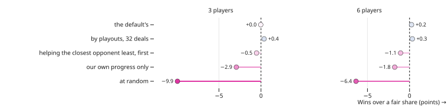
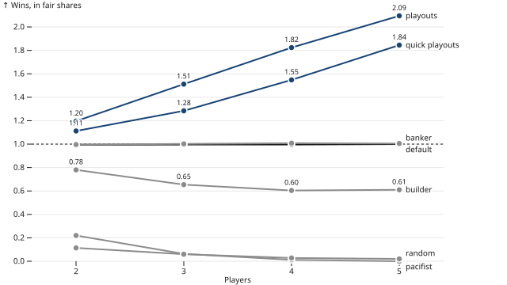

# Hilt

Hilt is a card game from CMYK's Magenta line, designed by Dominique Ehrhard, for 3 to 6 players.
It is a game of battles. Everyone is dealt 10 cards, and in each battle you go around the table
playing cards into a row in front of you, or passing, until everyone has passed. Whoever has
the highest total strength wins a chip. Three chips of a color, or one of each color, win the
game. Nobody draws between battles: cards you spend winning one are gone until the round ends,
when only one player has cards left.

This repo is a simulator of the game. It plays millions of games by the rules, so it can answer
the questions that come up at the table: how much the Favor card is worth, which cards matter,
and above all when to fight for a chip and when to let it go.

The answers come from the model, not from real tables. It follows the How to Play booklet, and
`CLAUDE.md` lists the readings the booklet leaves open. It hasn't been checked against real
games.

The simulator and this analysis were written with Claude Opus 5.5, working in Claude Code.

## A quick refresher

The deck is 96 cards: force cards worth 1 (15 of them), 2, 3, 4, 5, 6 and 10 (8 each), and fate
cards that change the battle:

- **Bait** (15): discard it to take a force card from your row back into your hand.
- **Fury** (6): your force cards count double, one Fury a player a battle.
- **Legend** (3): 10 strength that nothing changes.
- **Winter** (3): every force card in the battle is worth 1, once a battle.
- **Crows** (3): the battle ends at once, and whoever leads wins.
- **Doves** (3): the battle ends at once with no winner; the chip and the Favor stay where they
  are.

The Favor card goes to whoever won the last battle. Its holder picks which color of chip the next
battle is over, has 1 strength in their row before anyone plays, and acts last. Ties go to fewer
cards played, then the highest card, then clockwise from the Favor holder. Passing is for the
rest of the battle. When a battle leaves only one player with cards, they discard them, and
everyone is dealt 10 again, plus one card per chip they hold.

## Reading the numbers

Almost every number here is a win rate: the share of games one player wins, out of tens of
thousands played from different deals. Most tables seat one player of some kind at a table of
default players and rotate it through every seat, so seat order evens out.

- **A fair share** is what a player wins when nobody has an edge: 1 in however many are at the
  table, so 33.3% at 3 players and 16.7% at 6. A column headed "3 players (fair 33.3%)" says
  which share to compare with.
- **Points** are percentage points of win rate. A rule worth "+4 points" takes a player from
  33.3% to 37.3% of games. Points over a fair share are a win rate minus the fair share.
- **Fair shares** divide a win rate by a fair share instead: 2.0 fair shares wins twice as often
  as an even player would, 66.7% at 3 players or 33.3% at 6. They compare player counts, where
  the same points mean more at a bigger table.
- **A card's value** is in points too: how much more often a player wins with one more copy of it
  in their opening hand, in place of a random card, from the same deal played both ways.
- **Points a decision** (for the learned player) are the win chance one move adds over another at
  a single decision, from playing each out to the end.
- **The noise**, from playing a finite number of games: about ±0.5 points at 40,000 games, ±0.3 at
  100,000, and ±1.5 at 4,000. Differences smaller than that are a tie.

The charts are drawn from this README's own tables. After `pnpm install`, `node scripts/charts.ts`
redraws `charts/`.

## How the default player plays

Every table here is played by or against `defaultPolicy` in `src/game.ts`, a list of rules tried
in order. Each was found by playing out every legal move at the default's decisions
(`scripts/decisions.ts`) and adopted when it beat the default head to head (`scripts/variants.ts`):

1. Once everyone else has passed, Bait back the biggest force card that still leaves you ahead,
   then pass to win.
2. Crows when ahead with a card of your own played; Doves when someone else leads with the chip
   that wins them the game.
3. With nothing played and others still in, play a Fury, or else your strongest card, if you're
   ahead, as the Favor holder is at first.
4. Ahead with something played and others still in, play your weakest force card rather than
   pass: passing is final, and leaves them to overtake with nobody to answer.
5. Don't open a battle while 2 or more others are still in: let them spend their cards. Not
   when the chip would win you the game, or anyone else with fewer than 3 others in.
6. Otherwise open with a 1 or a Fury, the cheapest cards.
7. With nobody else left in, play your strongest card if your strongest 4 would overtake: nobody
   can answer, and rule 1 takes back what wasn't needed.
8. Behind with others still in, Bait back a 1: it keeps you in the battle for nothing. Or play
   a 1.
9. Behind, take the lead with the cheapest card that does it, while the battle has cost you at
   most 3 cards, or without limit when the chip decides the game.
10. Behind with the chip that wins you the game, play your strongest card even if it doesn't take
    the lead.
11. Before giving up a battle, Bait back your biggest force card.

Rule 4 came from the learned player (below), the first rule that did. Its moves differ from the
default's at 74% of its decisions at 3 players and 49% at 6, mostly by playing where the default
passed, and the largest group of those was ahead with a card down and one other still in, where
the default had no rule and passed. Playing the weakest force card there wins 50.5%, 34.7%,
26.4% and 21.8% at 3–6 players against the previous default (40,000 games), and 6, 2, 1.4 and
0.8 points more than it against the league. The strongest card does about as well against the
default and a little worse against the league. Only one on one gets most of it, 46.2% at 3
players; a 1 or a Fury instead gains under a point. The models still take the previous default's pick as one of their inputs, since that's
what they were trained on.

The first default, rules 2, 9 and 11 only, wins 12.4% at 3 players and 4.7% at 6 against a
field of later defaults. Each rule after it was the best answer to the default before, and
they don't settle: once everyone waits, opening pays again, and once everyone opens, waiting
does. So from the fifth round on, rules were also judged against a league, a default from every
round in each other seat (`variants.ts --field league`), and kept only if they won there too.
Bait back a 1 while ahead, for one, gains 4 to 7 points against today's default and loses a
point against the league.

### Against strong players

Each rule again, with playouts on 8 deals in every other seat, which beat the default
(`variants.ts --field playouts`, 6,000 games):

| without the rule | 3 players | 6 players |
| --- | --- | --- |
| today's default | 27.3% | 12.2% |
| deny every winning chip | 27.3% | 27.7% |
| open battles: don't wait | 30.6% | 19.1% |
| open with a 1 or Fury before waiting | 28.9% | 14.9% |
| only overtake with a single card | 28.2% | 12.9% |
| no 1 once something's played | 28.0% | 12.4% |
| press with the strongest card, not a Fury | 28.3% | 12.4% |
| open with a 1 or Fury with nobody else in | 26.9% | 12.3% |
| no Bait back after winning | 26.9% | 12.0% |
| pass only at a single card's reach of the lead | 26.6% | 12.0% |
| no Bait back of a 1 while others are in | 26.6% | 11.8% |
| Crows whenever ahead | 25.0% | 11.5% |
| pass when ahead with an empty row | 24.4% | 10.8% |
| the first default | 23.6% | 14.8% |

Two rules are bets on how the others play. Leaving a chip that wins someone the game for the
others to deny is worth 6 to 16 points among default players, which deny it once fewer than 3
are left. Among playouts, which expect the others to deny it and so don't, nobody does, and
denying it yourself is worth 15 points at 6 players. Waiting to open is the same bet: it pays
when the others fight, and against players who wait too, opening wins 3 to 7 points more. The
rest hold up or are within the noise (±1 point at 3 players, ±0.7 at 6).

Who should deny is a free-rider problem, and which answer wins depends on the table. One player
of each kind against a table of the other (40,000 games):

| one player | table | 4 players | 5 players | 6 players |
| --- | --- | --- | --- | --- |
| leaves it to others (the default) | denies every winning chip | 30.9% | 37.0% | 39.5% |
| denies every winning chip | leaves it to others | 22.5% | 15.9% | 12.4% |
| leaves it to others | opens without waiting | 40.0% | 44.1% | 42.9% |
| denies every winning chip | opens without waiting | 45.1% | 49.8% | 52.8% |

Among players who deny, leaving it to them wins twice a fair share at 6 players. Among players
who open every battle without waiting, denying yourself is better. At 3 players there's
never anyone else to leave it to.

Most of what the rules say is about cards as a budget. The 1s, Furies and Baits are cheap ways to
stay in a battle without spending anything that matters, and passing is final, so you play one
rather than pass. The 10s and Legends decide battles, so you spend them only when nobody can
answer, and take them back with Bait when you can.

## Going first

The Favor starts in seat 1, which acts last in the first battle. 100,000 default games
(`scripts/sim.ts`):

| players | seat 1 | seat 2 | seat 3 | seat 4 | seat 5 | seat 6 | battles | rounds |
| --- | --- | --- | --- | --- | --- | --- | --- | --- |
| 3 | 34.5% | 41.5% | 24.1% | | | | 6.7 | 1.5 |
| 4 | 29.3% | 32.3% | 20.6% | 17.8% | | | 8.0 | 1.4 |
| 5 | 25.1% | 27.6% | 17.9% | 15.0% | 14.4% | | 9.1 | 1.3 |
| 6 | 22.3% | 24.6% | 15.6% | 12.8% | 12.3% | 12.3% | 10.1 | 1.2 |

Seat 2, which acts first in the first battle, is best, at 1.25 fair shares at 3 players and
1.5 at 6. The Favor's seat is next. The first default, which fought every battle, gave the
Favor seat 40.5% at 3 players and 29.3% at 6 and seat 2 the worst share but one: who the first
battle favors depends on how people play it. Most games end in the first round: a player with
three or four chips is one battle from winning before anyone runs out.

## What each card is worth

The points one more copy in an opening hand adds, in place of a random card, from the same deal
played both ways (`scripts/cards.ts`, 200,000 deals each):

| card | 3 players | 4 players | 5 players | 6 players |
| --- | --- | --- | --- | --- |
| Fury | 5.3 | 3.6 | 3.9 | 3.5 |
| Crows | 5.2 | 4.5 | 5.3 | 5.7 |
| Legend | 4.3 | 3.3 | 2.9 | 2.5 |
| 10 | 3.9 | 3.5 | 2.9 | 2.5 |
| 1 | 1.0 | 0.3 | 0.2 | 0.3 |
| 6 | 0.4 | 0.5 | 0.2 | 0.2 |
| 5 | −0.6 | −0.3 | −0.5 | −0.5 |
| 4 | −1.6 | −1.0 | −1.2 | −1.1 |
| Bait | −2.1 | −2.1 | −1.8 | −1.4 |
| 3 | −2.7 | −1.9 | −1.8 | −1.7 |
| Winter | −3.8 | −2.5 | −2.4 | −2.3 |
| 2 | −4.4 | −3.3 | −3.1 | −2.7 |
| Doves | −7.1 | −6.2 | −5.9 | −5.2 |

These are against a random card, so a card worth nothing is about average. What a card is worth
depends on how it's played. Against the first default, which fought every battle and played
Crows whenever it led, a 10 or a Legend was worth 8 to 12 points and Crows −6.5 to −10. Played
as the default plays now, Fury and Crows are worth the most, a 1 beats a 6, and a 2 is near the
bottom: too big to stall with and too small to win.

## A learned player

The rules above top out well short of playouts, which play every legal move out to the end and
make the best one, but cost thousands of games a decision. So a player learned to predict what
playouts would say. `scripts/dataset.ts` plays default games and, at every decision of one player, plays every
legal move out to the end on 32 shared deals: about 250,000 decisions at each player count, in 10
minutes. `scripts/learn.py` fits gradient-boosted trees (LightGBM, 1,000 trees) to predict each
move's value from 40 numbers about the board and 19 about the move, and `src/learned.ts` plays
the move they rank first. On held-out games, this first model's pick gains 3.1 to 3.6 points of
win chance a decision over the default's:

| learned player | 3 players | 4 players | 5 players | 6 players |
| --- | --- | --- | --- | --- |
| against the default | 74.7% | 61.4% | 54.3% | 50.3% |
| against the league of defaults | 73.0% | 58.1% | 49.3% | 43.3% |
| against playouts on 8 deals | 53.6% | | | 27.9% |
| the default, against learned players | 8.8% | 6.7% | 7.9% | 8.8% |

It plays as well as playouts on 128 deals at a tiny fraction of the cost, and it isn't just
exploiting the default: it holds up against every earlier default and against playouts.

A learned player reaches boards the default never does, so each round after the first trains
on games the last round's learned player played, labeled the same way, with default players
inside the playouts (`dataset.ts --play`), and adds them to the earlier rounds' data. Each model
is then played against the default and against tables of the earlier models' players, 20,000
games each:

| model | against the default, 3 / 4 / 5 / 6 players | against round 0 | against rounds 0–1 |
| --- | --- | --- | --- |
| round 0: default games | 74.7 / 61.4 / 54.3 / 50.3 | 33.3 / 24.7 / 20.3 / 16.9 | |
| rounds 0–1: and the learned player's | 77.0 / 61.9 / 54.8 / 50.6 | 37.5 / 27.6 / 24.6 / 22.2 | 33.2 / 24.9 / 20.2 / 17.0 |
| rounds 0–2 | 77.5 / 62.0 / 55.6 / 51.6 | | 34.4 / 25.4 / 20.3 / 16.9 |

Round 1 gains 3 to 5 points against round 0's players, from seeing the boards a learned player
reaches. Round 2 ties it: the labels still ask which move is best if default players play on, and
the loop converges on the best answer to them.

So round 3 asks which move is best if learned players play on: rounds 0–1's learned player plays
the games, and a 200-tree version of it plays inside the playouts (`dataset.ts --rollout`), on 16
deals instead of 32. That costs 25 times as much a decision, so it's 3,000 games a player count,
about 55,000 decisions, in 33 minutes. Against 20,000 games each:

| model | against the default | against rounds 0–1 | against round 3 |
| --- | --- | --- | --- |
| rounds 0–1 | 77.0 / 61.9 / 54.8 / 50.6 | 33.2 / 24.9 / 20.2 / 17.0 | 20.6 / 20.2 / 18.4 / 16.9 |
| round 3 | 58.6 / 48.1 / 41.8 / 35.3 | 53.6 / 42.3 / 33.8 / 28.5 | 33.2 / 24.6 / 20.0 / 16.7 |
| rounds 0, 1 and 3 together | 75.6 / 60.8 / 53.3 / 47.6 | 34.5 / 25.6 / 19.4 / 16.6 | 21.4 / 20.0 / 18.1 / 15.4 |

At 3 to 6 players. Round 3's player beats a table of rounds 0–1's by 12 to 20 points, and wins
less against the default: what the labels assume about the others decides whom the player
beats, as with the rules. Mixed in with the default-labeled rounds, round 3's labels wash out.

Round 4 does it again with round 3's player in the games and the playouts (`dataset/model-r3s`):

| model | against the default | against rounds 0–1 | against round 3 |
| --- | --- | --- | --- |
| round 4's games alone | 49.8 / 51.8 / 43.8 / 38.8 | 44.5 / 30.1 / 19.9 / 14.6 | 43.5 / 41.2 / 39.8 / 36.4 |
| rounds 3 and 4 together | 56.3 / 53.9 / 48.2 / 44.5 | 53.9 / 40.9 / 31.7 / 25.4 | 44.6 / 41.3 / 39.6 / 36.7 |

Rounds 3 and 4 together beat round 3's players by 11 to 20 points, keep round 3's edge over
rounds 0–1's, and do better against the default at 4 to 6 players, so from here on each round's
model is fit to every round's games from round 3 on, and "round 4" means that model. It holds up
elsewhere too:

| round 4 | 3 players | 4 players | 5 players | 6 players |
| --- | --- | --- | --- | --- |
| against the league of defaults | 62.6% | 53.0% | 44.6% | 38.3% |
| against playouts on 8 deals | 59.6% | | | 34.3% |
| rounds 0–1, against them | 11.3% | 11.2% | 7.2% | 5.2% |
| the default, against them | 2.8% | 4.6% | 4.5% | 3.8% |

Each round after that does the same again from the model before it, adding its games to the
data so far. One player of each model at a table of the model before it, 20,000 games each:

| round | at a table of | 3 players | 4 players | 5 players | 6 players |
| --- | --- | --- | --- | --- | --- |
| 3 | rounds 0–1 | 53.6% | 42.3% | 33.8% | 28.5% |
| 4 | round 3 | 44.6% | 41.3% | 39.6% | 36.7% |
| 5 | round 4 | 39.3% | 29.5% | 23.7% | 20.3% |
| 6 | round 5 | 37.1% | 26.7% | 22.1% | 18.7% |
| 7 | round 6 | 34.6% | 27.1% | 22.3% | 18.6% |
| 8 | round 7 | 34.4% | 26.7% | 21.3% | 17.7% |
| 9 | round 8 | 33.4% | 25.9% | 20.5% | 17.3% |
| 10 | round 9 | 34.0% | 25.3% | 20.5% | 17.0% |

And each against the default:

| round, against the default | 3 players | 4 players | 5 players | 6 players |
| --- | --- | --- | --- | --- |
| 3 | 58.6% | 48.1% | 41.8% | 35.3% |
| 4 | 56.3% | 53.9% | 48.2% | 44.5% |
| 5 | 49.7% | 51.2% | 46.8% | 42.6% |
| 6 | 40.7% | 46.5% | 41.6% | 36.2% |
| 7 | 42.2% | 45.9% | 40.5% | 34.1% |
| 8 | 38.7% | 44.5% | 37.9% | 33.0% |
| 9 | 41.1% | 43.3% | 37.1% | 32.0% |
| 10 | 43.0% | 43.3% | 36.8% | 31.6% |

Every round still beats the one before, by less each time: round 7 by 1.3 to 2.3 points over a
fair share, against round 6's 1.7 to 3.8. Each also beats the older models by more than the one
before it did: round 7 beat a table of round 5's 38.8%, 29.0%, 24.6% and 20.0%, where round 6
managed 37.1%, 26.7%, 22.1% and 18.7%. Against the default they've won less since round 4, as
they learn to beat learned players instead, and round 7 about holds there.

Round 8 gains 1.0 to 1.7 points over round 7, less again, and beats every older model by more
than round 7 did: a table of round 6 wins it 35.4%, 29.0%, 23.4% and 19.6%, round 5 38.7%,
30.7%, 25.1% and 21.1%, and round 4 45.6%, 33.1%, 27.5% and 24.3%. Against the default it loses
another 1 to 3.5 points.

Round 9 gains 0.5 to 0.9 points over round 8 at 4 to 6 players and ties it at 3 (33.4%). Against
older models it does about as well as round 8 did, within half a point either way, so the rounds
are levelling off. Against the default it wins 2.4 points more at 3 players and about a point less
at 4 to 6. Round 9 is `src/model.json` now.

Round 10 played twice the games (6,000 a player count) and gains only 0.3 to 0.7 points over
round 9, within the noise, so it wasn't adopted. Against older models it does a little better than
round 9 did (a table of round 8 wins it 34.7%, 26.2%, 20.6% and 17.4%), but by less than a point.
More games of the same kind don't restart the gains.

## Which chip to fight over

The Favor holder picks the chip for the next battle. The default picks the one that leaves it
fewest chips from winning, then the one that helps the closest opponent least (`pickColor`).
Against the default (`variants.ts`, 40,000 games):

| chip | 3 players | 4 players | 5 players | 6 players |
| --- | --- | --- | --- | --- |
| the default's | 33.3% | 25.2% | 20.0% | 16.9% |
| by playouts, 32 deals | 33.7% | 25.6% | 20.2% | 17.0% |
| helping the closest opponent least, first | 32.8% | 24.2% | 18.7% | 15.6% |
| our own progress only | 30.4% | 23.1% | 17.7% | 14.9% |
| at random | 23.4% | 17.0% | 12.9% | 10.3% |

The pick is worth 7 to 10 points, and the default's rule gets nearly all of it: playing each chip
out gains under half a point. Your own progress comes first, but ignoring everyone else's costs 2
to 3 points.

## Discarding a hand with no force cards

A player who passes with no force cards in hand may show it and discard it. Nobody draws until
only one player has cards left, so emptying your hand brings the next deal closer, when you get
10 fresh cards and one more a chip. The default always does. Against the default (`variants.ts`,
40,000 games):

| on passing with no force cards | 3 players | 4 players | 5 players | 6 players |
| --- | --- | --- | --- | --- |
| discard (the default) | 33.3% | 25.2% | 20.0% | 16.9% |
| discard or keep, by playouts on 32 deals | 33.6% | 25.4% | 20.2% | 17.0% |
| keep the hand | 30.6% | 23.5% | 19.0% | 16.3% |

Always discarding is as good as playing each choice out: the fate cards left in such a hand are
worth less than getting to the next deal sooner. Keeping them costs 2.7 points at 3 players and
0.6 at 6.

## Strategies

One player of each against the default in every other seat (`scripts/strategies.ts`, 100,000
games; playouts 4,000):

| strategy | 3 players | 4 players | 5 players | 6 players |
| --- | --- | --- | --- | --- |
| default | 33.3% | 25.2% | 20.0% | 16.7% |
| learned, rounds 0–1 | 77.0% | 61.9% | 54.8% | 50.6% |
| learned, round 5 | 49.7% | 51.2% | 46.8% | 42.6% |
| playouts, 128 deals | 73.5% | 61.2% | 56.2% | 54.8% |
| playouts, 32 deals | 63.9% | 51.8% | 44.2% | 40.5% |
| playouts, 8 deals | 40.0% | 27.9% | 25.2% | 22.4% |
| spender: chase every battle | 5.7% | 1.6% | 1.2% | 1.0% |
| no Bait | 5.5% | 1.5% | 1.2% | 1.0% |
| random | 2.5% | 1.6% | 1.3% | 1.0% |
| passive: never play | 0.0% | 0.0% | 0.0% | 0.0% |

Playouts play out every legal move to the end of the game on deals of the cards they can't see,
with the default playing on, and make the one that wins most. Against the first default, 32
deals won 84% at 3 players and 76% at 6; each round of rules took some of that away. More deals
still help a lot, so there's plenty more to how Hilt should be played than the default's rules.
Spending to win every battle is ruinous, and so is never taking a card back with Bait. The
learned players are in "A learned player": rounds 0–1 learned to beat default players, round 5
to beat learned ones, and at a table of each other round 5 wins. The later rounds are in
"A learned player"'s tables.

Playouts can also race: play the moves out 8 deals at a time on the same deals, and drop a move
once it's 2 standard errors behind the leader, until each move left has had its full number of
deals. That spends the deals on the moves still in contention. They can also play out only the
3 moves the learned model ranks highest. Against the default (4,000 games):

| playouts | 3 players | 4 players | 5 players | 6 players |
| --- | --- | --- | --- | --- |
| racing, up to 128 deals | 72.3% | 60.8% | 54.2% | 53.9% |
| racing, the model's top 3 moves | 68.3% | 60.6% | 52.6% | 50.8% |
| racing, up to 512 deals | 75.7% | 64.1% | 58.5% | 56.7% |
| racing, up to 512 deals, the model's top 3 moves | 70.3% | 63.2% | 54.8% | 52.0% |

Racing on 128 deals costs 0.6 times as much as 128 full deals and wins about a point less.
Pruning to the model's top 3 loses 1 to 5 points (±1.5 is noise here): the best move is often
one the model ranks lower, and playouts would have found it.

## Rule readings

The booklet leaves one thing open that a flag in `Rules` reads either way: whether a Favor holder
with no cards left still has the Favor's 1 strength. It comes up in 1.3% of battles at 3 players
and 4% at 6, and either reading gives the same wins by seat and the same game length within the
noise (`scripts/rules.ts`, 100,000 default games each). The simulator reads it as yes.
