# Fives

Fives is a trick-taking card game from CMYK's Magenta line, designed by Taiki Shinzawa, for 3 or 4
players. You follow the led color if you can, silver is trump, and the winner of each trick keeps
the card they won it with. The twist is the target: at the end of the hand you want those cards to
add up to 25, or as close as you can get without going over. And every card's back is a magenta
5, so any card can be played face down as one.

This repo is a simulator of the game. It plays millions of games by the rules, so it can answer
the questions that come up at the table: when to take a trick and when to duck it, what to do with
high cards, and when to flip a card to its magenta 5.

The answers come from the model, not from real tables. It follows the How to Play booklet, and
`CLAUDE.md` lists the readings the booklet leaves open. It hasn't been checked against real games.

You can play it against its bots, or with friends, at [fives.visnup.com](https://fives.visnup.com).

The simulator and this analysis were written with Claude Opus 5.5, working in Claude Code.

## A quick refresher

The deck is 52 cards: 1 to 13 in blue, green and silver, and 0 to 4 and 6 to 13 in magenta. At 3
players the 10s to 13s come out, and everyone gets 12 cards; at 4, everyone gets 13.

- Whoever holds the magenta 0 leads the first trick of each hand, with any card. The winner of a
  trick leads the next.
- Follow the led color if you can. The highest silver wins, or else the highest of the led color.
- Any card can be played face down as a magenta 5, one a trick: when you lead, when magenta is led
  (even if you hold magenta), when you can't follow, and when your last card of the led color is
  the one you flip.
- Your total is the cards you won tricks with, a face-down one counting 5. Closest to 25 without
  going over takes 3 chips at 4 players (2 at 3), second 2 (1), third 1, and exactly 25 one more.
  Tied players all take the lower place, as the booklet says; that decides 10% of hands' chips at
  3 players and 14% at 4, but taking the higher place instead moves no player's wins beyond the
  noise (`scripts/rules.ts`, 20,000 games). A bust gives one of their chips to the closest player.
- Everyone starts with 5 chips. After 4 hands, the most chips wins.

## How to play better

What the simulator has found so far, most important first. Each rule is one the default player
follows, and each gain is in points of win rate (below) against a player without it.

1. **Your face-down 5 is for getting rid of high cards.** A card you flip counts 5 if it wins,
   whatever it was face up. A player who never flips loses 24 points at 3 players and 20 at 4.
2. **When you lead and you're 5 or more from 25, lead face down.** Flip your highest silver, or
   your highest card if you have no silver. Why silver first is a guess, not something the
   simulator shows: a high silver is the card most likely to win a trick you didn't want and add
   its whole value to your total, and led face down it's a magenta 5 at most.
   Leading your lowest card face up, the obvious play, is far worse: this rule alone wins about
   two games in three at 3 players against a table that doesn't follow it.
3. **Take a trick you're sure to win if it doesn't bust you,** first of all one that makes exactly
   25.
   "Sure" means nobody still to play can beat it, counting the cards you've seen and the colors
   others have shown they're out of.
4. **At 4 players, early in a hand, don't take a trick as the last to play** unless you're within
   12 of 25. Play under it instead: +3.5 points at 4 players, nothing at 3.
5. **Otherwise play under the trick, with your biggest card that loses.** Ducking is how you shed
   high cards when you can't flip them.
6. **Once you've busted, dump your biggest cards.** Nothing more can be lost this hand.

A table that follows all six beats one following only 3, 5 and 6 by a wide margin: one of them
wins 69.0% at 3 players and 57.1% at 4 among the old players, and one old player wins only 10.9%
and 5.8% among the new. The learned player still wins 62.2% and 63.2% against them, so there's
more to find.

## Reading the numbers

Almost every number here is a win rate: the share of games one player wins, out of thousands played
from different deals. Most tables seat one player of some kind at a table of default players and
rotate it through every seat, so seat order evens out. A shared win counts as a share.

The charts are drawn from this README's own tables. After `pnpm install`, `node scripts/charts.ts`
redraws `charts/`.

- **A fair share** is 1 in however many are at the table: 33.3% at 3 players and 25% at 4.
- **Points** are percentage points of win rate.
- **Points a decision** (for the learned player) are the win chance one play adds over another at a
  single decision, from playing each out.
- **The noise**, from playing a finite number of games: about ±1.5 points at 4,000 games and ±0.5
  at 40,000.

## The players

- **The default** (`defaultPolicy` in `src/game.ts`) plays the rules in "How to play better", and
  if every play wins, the biggest that doesn't bust. It's the Medium bot online.
- **Playouts** try every legal play: copy the game, deal the cards you can't see again at random
  (respecting colors someone has shown they're out of), play on with the default everywhere, and
  make the play that wins most. Playing only to the end of the hand and scoring it by the chance
  of winning from the chips (`chance`, a softmax fit to default games) is both cheaper and
  stronger than playing all four hands out.
- **The learned player** (`src/learned.ts`) scores each play with gradient-boosted trees fit to
  playout values, so it plays about as well as playouts at a tiny fraction of the cost. Each round
  of training labels the games of the last round's learned player, with learned players inside
  the playouts.

One player against the default in every other seat (4,000 games; 20,000 for the learned player):

| player | 3 players (fair 33.3%) | 4 players (fair 25.0%) |
| --- | --- | --- |
| learned, round 9 | 62.2% | 63.2% |
| face up only (never a magenta 5) | 7.2% | 5.2% |
| random | 4.2% | 2.3% |
| greedy: take the lead whenever it doesn't bust | 3.4% | 0.2% |

Playouts were last measured against the default before the rules below, which they beat by
more: hand playouts on 32 deals won 96.6% and 92.1%, on 16 deals 94.9% and 86.1%, and full-game
playouts on 32 deals 95.3% and 82.4% (800 games).

The default against itself busts in 38% of hands at 4 players and 25% at 3, and hits 25 exactly in
6% and 9% (100,000 games). Seats don't matter: each wins within half a point of a fair share,
since whoever holds the magenta 0 leads each hand. Leading a hand does matter at 4 players: the
first leader busts 22% of hands to everyone's 38% and gains 1.8 chips a hand to 1.4, and a player
who leads two of the four hands wins 28.0% to the 22.3% of one who leads none (40,000 games). At 3
players it's worth nothing. That's holding the magenta 0 as much as leading, and the two aren't
separated here. Never playing a card face down costs it 24 points at 3 players and 20 at 4: the magenta
5 is how you get rid of a high card without adding more than 5 to your total.

### Where rules 2 and 4 came from

Both came from where round 9's learned player chose differently from the default
(`scripts/overrules.ts`), and each was kept only if it also beat a table of every earlier default
(40,000 games against the default, 10,000 to 20,000 against the rest):

| rule | against the default | against earlier defaults | against the learned player |
| --- | --- | --- | --- |
| lead your highest card face down, 5+ from 25 (the default used to lead its lowest face up) | +31.8, +24.7 | | +6.2, +2.7 |
| flip your highest silver first | +8.3, +11.3 | +5.8, +6.6 | +1.9, +0.9 |
| at 4 players, last to play early, take only within 12 of 25 | +3.5 at 4 players | +4.3 | +0.8 |

Leading the lowest card face down, or the highest face up, doesn't help, and 5 to go beats 3, 7
or 10 as the cutoff. Flipping the lowest silver does worse than not preferring silver at all.
Two more of the learned player's habits didn't make rules: ducking with your lowest losing card
when last early in a hand, and taking with your highest card of the led color when second to play
early. Each cost 2 to 4 points.

## When to play a magenta 5

How often round 9's learned player, the strongest player here, plays face down when it may and
has a choice, at a table of learned players (8,000 games, `scripts/flips.ts`). The default flips
every time in most of these rows.

| when | flips, 3 players | flips, 4 players | what it flips |
| --- | --- | --- | --- |
| leading, 6 or more from 25 | 55–59% | 67–68% | a high card, silver about half the time |
| leading, within 5 | 37% | 38% | |
| can't follow or flipping your last card of the color, within 5 | 65–79% | 76–81% | its highest card, 5 times in 6 when it can't follow |
| the same, 13 or more from 25 | 68–71% | 63–65% | often a silver, rarely its highest |
| magenta led, 6 or more from 25 | 69–75% | 78–83% | |
| busted | 46–62% | 38–62% | |

Leading accounts for two thirds of these chances. Close to 25, flip your biggest card when you
can't follow: it counts 5 if it wins, so it's the safest way to shed it. Far from 25, flip a silver
you'd rather not win a trick with. The strong player flips less than the default when leading and
once it's busted, and more when magenta is led and it's far from 25; none of those has been
tested as a rule yet.

## Rounds

Each round labels 4,000 games a player count (8,000 from round 4, 32 deals in round 6, and 12,000 from round 7, with card-counting features fit only to rounds 7 on; round 8's playouts score a hand's end by a `chance` refit to learned players' games, and round 9's play two hands, fit with 1,500 trees of 127 leaves) played by the round before's learned player, each
play valued by hand playouts on 16 deals among learned players (round 0: default games and
default players, 32 deals). Each model at a table of the one before it (20,000 games, 10,000 from round 5; round 0's against the default, 4,000):

| round | 3 players | 4 players |
| --- | --- | --- |
| 1 | 47.5% | 38.6% |
| 2 | 42.2% | 39.9% |
| 3 | 37.1% | 27.5% |
| 4 | 35.3% | 26.5% |
| 5 | 34.8% | 25.2% |
| 6 | 34.7% | 24.9% |
| 7 | 33.5% | 26.0% |
| 8 | 33.5% | 25.8% |
| 8, refit with 1,500 trees of 127 leaves | 35.1% | 25.5% |
| 9 | 33.7% | 25.9% |
| 10, on its own games | 29.8% | 23.7% |
| 10, refit on rounds 7–10 | 32.8% | 24.8% |
| 11, 64 deals a label, one hand, against round 9 | 31.7% | 24.6% |

Round 10 is the first labeled with today's default as the "is the default's pick" input. Fit only
to its own games it lost to round 9; refit to rounds 7–10 it ties it, and wins 62.8% and 63.0%
against today's default to round 9's 62.2% and 63.2%. Round 11 labeled with 64 deals instead of 16,
one hand deep, and fit to rounds 10–11: it beats round 10 (36.2%, 26.3%) and the default (64.2%,
62.1%), and still loses to round 9. So round 9 stays the Hard bot, and rounds have stopped gaining.

And against the default before it led face down (round 9 wins 62.2% and 63.2% against today's):

| round, against the default | 3 players | 4 players |
| --- | --- | --- |
| 0 | 87.0% | 79.6% |
| 1 | 79.6% | 78.0% |
| 2 | 82.8% | 84.7% |
| 3 | 84.6% | 85.3% |
| 4 | 87.1% | 86.2% |
| 5 | 88.2% | 86.7% |
| 6 | 88.9% | 86.8% |
| 7 | 89.4% | 86.4% |
| 8 | 89.5% | 87.4% |
| 9 | 91.0% | 88.6% |
