# Fives

Fives is a trick-taking card game from CMYK's Magenta line, designed by Taiki Shinzawa, for 3 or 4
players. You follow the led color if you can, silver is trump, and the winner of each trick keeps
the card they won it with. The twist is the target: at the end of the hand you want those cards to
add up to 25, or as close as you can get without going over. And every card's back is a magenta
5, so any card can be played face down as one.

This repo is a simulator of the game. It plays millions of games by the rules, so it can answer
the questions that come up at the table: when to take a trick and when to duck it, what to do with
high cards, and when to flip a card to its magenta 5.

The answers come from the model, not from real tables. It follows the How to Play booklet, and
`CLAUDE.md` lists the readings the booklet leaves open. It hasn't been checked against real games.

The simulator and this analysis were written with Claude Opus 5.5, working in Claude Code.

## A quick refresher

The deck is 52 cards: 1 to 13 in blue, green and silver, and 0 to 4 and 6 to 13 in magenta. At 3
players the 10s to 13s come out, and everyone gets 12 cards; at 4, everyone gets 13.

- Whoever holds the magenta 0 leads the first trick of each hand, with any card. The winner of a
  trick leads the next.
- Follow the led color if you can. The highest silver wins, or else the highest of the led color.
- Any card can be played face down as a magenta 5, one a trick: when you lead, when magenta is led
  (even if you hold magenta), when you can't follow, and when your last card of the led color is
  the one you flip.
- Your total is the cards you won tricks with, a face-down one counting 5. Closest to 25 without
  going over takes 3 chips at 4 players (2 at 3), second 2 (1), third 1, and exactly 25 one more.
  Tied players all take the lower place. A bust gives one of their chips to the closest player.
- Everyone starts with 5 chips. After 4 hands, the most chips wins.

## Reading the numbers

Almost every number here is a win rate: the share of games one player wins, out of thousands played
from different deals. Most tables seat one player of some kind at a table of default players and
rotate it through every seat, so seat order evens out. A shared win counts as a share.

The charts are drawn from this README's own tables. After `pnpm install`, `node scripts/charts.ts`
redraws `charts/`.

- **A fair share** is 1 in however many are at the table: 33.3% at 3 players and 25% at 4.
- **Points** are percentage points of win rate.
- **Points a decision** (for the learned player) are the win chance one play adds over another at a
  single decision, from playing each out.
- **The noise**, from playing a finite number of games: about ±1.5 points at 4,000 games and ±0.5
  at 40,000.

## The players

- **The default** (`defaultPolicy` in `src/game.ts`) is a few hand-written rules: once busted, dump
  your biggest card; when you lead with 5 or more to go, lead your highest trump face down, or
  your highest card if you have no trump; take a trick you're sure to win if it makes exactly 25
  or doesn't bust, except at 4 players when you play last early in a hand, more than 12 from 25;
  else
  play under the trick, dumping your biggest card that loses; and if every play wins, the biggest
  that doesn't bust. "Sure" means nobody still to play can hold a card that beats it, counting
  what's been seen. It's weak, which is the point of what follows.
- **Playouts** try every legal play: copy the game, deal the cards you can't see again at random
  (respecting colors someone has shown they're out of), play on with the default everywhere, and
  make the play that wins most. Playing only to the end of the hand and scoring it by the chance
  of winning from the chips (`chance`, a softmax fit to default games) is both cheaper and
  stronger than playing all four hands out.
- **The learned player** (`src/learned.ts`) scores each play with gradient-boosted trees fit to
  playout values, so it plays about as well as playouts at a tiny fraction of the cost. Each round
  of training labels the games of the last round's learned player, with learned players inside
  the playouts.

One player against the default in every other seat (4,000 games; 20,000 for the learned player):

| player | 3 players (fair 33.3%) | 4 players (fair 25.0%) |
| --- | --- | --- |
| learned, round 9 | 62.2% | 63.2% |
| face up only (never a magenta 5) | 7.2% | 5.2% |
| random | 4.2% | 2.3% |
| greedy: take the lead whenever it doesn't bust | 3.4% | 0.2% |

Playouts were last measured against the default before the rules below, which they beat by
more: hand playouts on 32 deals won 96.6% and 92.1%, on 16 deals 94.9% and 86.1%, and full-game
playouts on 32 deals 95.3% and 82.4% (800 games).

The default against itself busts in 38% of hands at 4 players and 25% at 3, and hits 25 exactly in
6% and 9%. Never playing a card face down costs it 24 points at 3 players and 20 at 4: the magenta
5 is how you get rid of a high card without adding more than 5 to your total.

### What the learned model taught the default

Three rules, each from where round 9's learned model played differently from the default, and
each kept only if it also beat a table of every earlier default. Together they take the default
from a fair share to 69.0% at 3 players and 57.1% at 4 against its old self (40,000 games), and
the old default in one seat against the new one wins only 10.9% and 5.8%.

- **Lead high, face down.** When you lead and you're 5 or more from 25, play a high card face
  down. It leads a magenta 5, and the card you give up is the one most likely to bust you later;
  if the 5 wins the trick, it scores only 5. The default used to lead its lowest card face up.
  This rule alone took it to 65.3% and 49.4% against its old self. Leading the lowest card face
  down, or the highest face up, doesn't help, and 5 to go beats 3, 7 or 10 as the cutoff.
- **Flip your highest trump first.** The card to flip is your highest silver if you have one, else
  your highest card: +8.3 and +11.3 points more. A high silver wins whatever trick it's played on,
  so it's the card that most surely adds its full value to your total. Flipping the lowest silver
  instead does worse than not preferring silver at all.
- **At 4 players, don't take early when you play last.** If you're last to play to a trick early
  in a hand and more than 12 from 25, play under even when you could take it safely: +3.5 points
  at 4 players, and nothing at 3.

Two more of the model's differences didn't make rules: ducking with your lowest losing card
instead of your highest when last early in a hand, and taking with your highest card of the led
color when second to play early. Each cost 2 to 4 points at 4,000 games.

## Rounds

Each round labels 4,000 games a player count (8,000 from round 4, 32 deals in round 6, and 12,000 from round 7, with card-counting features fit only to rounds 7 on; round 8's playouts score a hand's end by a `chance` refit to learned players' games, and round 9's play two hands, fit with 1,500 trees of 127 leaves) played by the round before's learned player, each
play valued by hand playouts on 16 deals among learned players (round 0: default games and
default players, 32 deals). Each model at a table of the one before it (20,000 games, 10,000 from round 5; round 0's against the default, 4,000):

| round | 3 players | 4 players |
| --- | --- | --- |
| 1 | 47.5% | 38.6% |
| 2 | 42.2% | 39.9% |
| 3 | 37.1% | 27.5% |
| 4 | 35.3% | 26.5% |
| 5 | 34.8% | 25.2% |
| 6 | 34.7% | 24.9% |
| 7 | 33.5% | 26.0% |
| 8 | 33.5% | 25.8% |
| 8, refit with 1,500 trees of 127 leaves | 35.1% | 25.5% |
| 9 | 33.7% | 25.9% |

And against the default before it led face down (round 9 wins 62.2% and 63.2% against today's):

| round, against the default | 3 players | 4 players |
| --- | --- | --- |
| 0 | 87.0% | 79.6% |
| 1 | 79.6% | 78.0% |
| 2 | 82.8% | 84.7% |
| 3 | 84.6% | 85.3% |
| 4 | 87.1% | 86.2% |
| 5 | 88.2% | 86.7% |
| 6 | 88.9% | 86.8% |
| 7 | 89.4% | 86.4% |
| 8 | 89.5% | 87.4% |
| 9 | 91.0% | 88.6% |
