# Monopoly Deal

Monopoly Deal is Hasbro's card game of Monopoly: 106 cards, no board, no dice, and games that
last fifteen minutes. You bank money, lay down properties and charge rent like the board game,
but most of the cards are actions that take from other players: Sly Deal steals a property, Deal
Breaker steals a whole set, and Just Say No stops either. The first player with three full sets
wins.

This repo is a simulator of the game. It plays millions of games by the rules, so it can answer
the questions that come up at the table: whether going first matters, which cards are worth
keeping, which sets to chase, whether to build houses, and when to lay your properties down.

The answers come from the model, not from real tables. It follows the rule sheet of the 2023 US
edition (G0351), and the rules the sheet leaves open are measured both ways (see "Rules
questions"). The 2014 sheet (B0965) differs in three readings that together move the first
player's share by 0.4 points at most. It hasn't been checked against logged real games yet.

The simulator and this analysis were written with Claude Opus 5.5 at medium effort, working in Claude
Code throughout.

## A quick refresher

Everyone is dealt 5 cards. Each turn you draw 2 (5 if your hand is empty) and play up to 3:

- **Money and action cards into your bank.** Every action card can be banked as money instead.
- **Properties onto the table**, into sets by color. A set is 2 to 4 cards; dark blue, brown and
  utility take 2, railroads 4, the rest 3. Wilds count as one of two colors, or the two
  multicolored ones as any, and can be moved between sets on your own turn.
- **Actions.** Rent charges for one of your colors: a two-color Rent card charges everyone, the
  any-color one charges one player, and Double the Rent doubles it. Debt Collector takes $5M from
  one player and It's My Birthday $2M from everyone. Sly Deal takes a property, Forced Deal swaps
  one, and Deal Breaker takes a full set. Pass Go draws 2. A House or Hotel adds rent to a full
  set.

You pay what you owe from your bank and your properties, your choice, and get no change. If you
can't pay it all, you pay everything you have. Just Say No cancels any action against you, and
can itself be cancelled by another. You end your turn with at most 7 cards in hand. Three full
sets of different colors win. The sheet doesn't say what happens when the draw pile runs out;
here the cards played are shuffled into a new one (see "Rules questions").

## How to read the numbers

**Share of wins** is the measure throughout. A full set doesn't count unless it's your third, and
money in the bank isn't worth anything at the end, so every other measure is a step toward a
win at best.

**A fair share** is 100% ÷ players: 50% at 2 players, 20% at 5.

**Points** are percentage points of a share of wins, never money or cards: winning 21.7% of games
instead of 20.0% is +1.7 points.

**One hand-written player** plays every seat, or every seat but one: `defaultPolicy` in
`src/game.ts`. It tries a list of rules in order and makes the first move one allows: Pass Go,
complete a set, Deal Breaker, Sly Deal, charge rent, Debt Collector, Birthday, Forced Deal, lay
down once $10M is banked, bank, and only then lay down properties. Every table depends on how well it plays, and "Playing well" shows how
that list was found and how far it is from the best play we know.

**Noise.** Most tables are 100,000 games per cell, so a share of wins is good to about ±0.3
points, two standard errors. Games are played from seeded deals, so a comparison plays both sides
on the same deals.

**Stalled** games are ones with no winner after 200 turns. They count as a win for no one.
"Stalled games" says where they come from.

Node 26 runs everything with no dependencies, and each section names the script behind it:

```bash
node scripts/sim.ts --n 100000 --players 4
```

The charts are drawn from this README's own tables, so they stay in step with them. After
`pnpm install`, `node scripts/charts.ts` redraws `charts/`.

## Going first

*From `node scripts/sim.ts`*, with the default player in every seat:

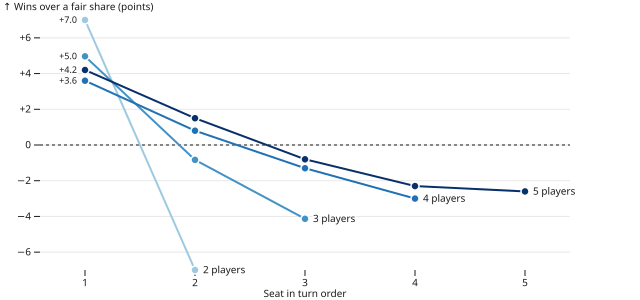

| players | first | second | third | fourth | fifth | turns per game | draw pile reshuffled |
| --- | --- | --- | --- | --- | --- | --- | --- |
| 2 | 57.0% | 43.0% | | | | 16.4 | 0.0% |
| 3 | 38.3% | 32.5% | 29.2% | | | 21.3 | 0.4% |
| 4 | 28.6% | 25.8% | 23.7% | 22.0% | | 25.6 | 13.8% |
| 5 | 24.2% | 21.5% | 19.2% | 17.7% | 17.4% | 29.0 | 45.0% |

**Going first is worth 14.0 points at 2 players.** That's 33% more wins than the second player.
At 5 players the edge is 4.2 points over a fair share, and later seats win less, down to 17.4%
for the last. The first player starts drawing and playing a turn ahead, and in a 16-turn
2-player game, that turn matters more.

**A game lasts about 8 rounds at 2 players and 5 to 6 at 5.** A round is a turn for each player.

**The draw pile runs out in nearly half of 5-player games.** It holds 106 − 5 × 5 = 81
cards after the deal. It almost never runs out at 2 or 3 players.

## Which strategy wins

*From `node scripts/strategies.ts`*, which seats one player of each strategy in
`src/strategies.ts` against the default player in every other seat, rotating seats. Playouts are
slow, so they play 10,000 games per cell, which is good to about ±1 point.

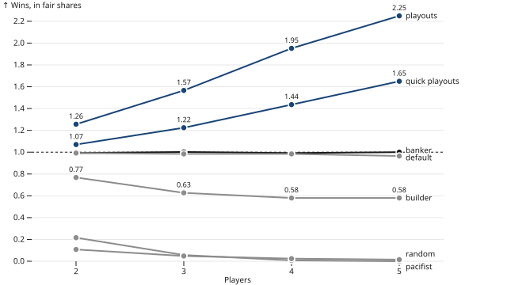

| strategy | 2 players (fair 50.0%) | 3 players (fair 33.3%) | 4 players (fair 25.0%) | 5 players (fair 20.0%) |
| --- | --- | --- | --- | --- |
| default | 49.6% | 33.4% | 24.8% | 20.0% (1 stalled) |
| builder | 38.4% | 20.9% | 14.5% | 11.6% |
| banker | 49.6% | 32.8% | 24.6% | 19.3% (2 stalled) |
| pacifist | 10.8% | 1.9% (5 stalled) | 0.2% (19 stalled) | 0.0% (64 stalled) |
| random | 5.4% | 1.6% | 0.6% | 0.3% |
| playouts | 62.8% | 52.2% | 48.8% | 45.0% |
| quick playouts | 53.5% | 40.8% | 35.9% | 33.0% |

**Builder** plays the way the default player first did. It lays down properties as soon as it
draws them, builds houses and hotels, and only then charges rent. It wins 11 points less than the
default at 2 players, and more than a third fewer games at 5. "Playing well" breaks that gap down.

**Banker** banks $10M before anything else. That's now within a point of the default, which
already banks its money before laying properties down.

**Pacifist** never takes from anyone and banks every action card. It almost never wins: this is a
game of taking.

**Random** plays a legal move at random. It's the floor.

**Playouts** has no rules of its own. It tries each option by imagining how it turns out, the way
a chess player thinks a few moves ahead, except by trial instead of reasoning. Before every play
it lists everything it could do: each card it could bank, lay down or play, at each target, or
ending its turn, and keeps the 5 a model trained on earlier playouts likes best ("A learned
player" below). For each it plays the game forward many times on a copy of the table,
with the default player making every choice from there, and it picks the option that came out
ahead most often.

It can't see the other hands or the draw pile, so each time it imagines them by shuffling the
cards it can't see and dealing them out again. It doesn't peek: it only knows what a player at
the table would. Different shuffles turn out differently, so it tries each option on 8 shuffles
at a time, drops any option that's clearly behind, and keeps going with the rest, up to 160
shuffles. This is a Monte Carlo search; the name comes from the casino, since it learns by
rolling the dice.

It doesn't play each imagined game to the end. It stops two rounds ahead, when everyone has had
two more turns, and judges the table instead: a formula fitted to thousands of games that turns
full sets, progress toward more, money and the cards in hand into each player's chance to win
(`scripts/chance.ts`). That's faster, and it plays better. Playing every imagined game to the end,
it won 50.3%, 39.5%, 36.4% and 33.7%, probably because the further ahead it looks, the more each
result depends on the draw and on the default player's weaker choices than on the option tried. It wins 13 to 25 points more than the default, so there is still a lot
to find. It also pays, says no and discards by the learned models ("Paying, saying no and
discarding").

**Quick playouts** is the same with less imagining and no model: every option, 16 shuffles each,
one round ahead. It's about 6 times faster (the row took 4 minutes on 20 cores, against 26) and
still wins 4 to 13 points more than the default: a strong opponent that's cheap enough to play
against.

**Skill counts for more at big tables.** Against the default, playouts win 1.26 fair shares at
2 players and 2.25 at 5. At 2 players the weaker player still wins nearly 4 games in 10; at 5,
the four default players together win only 55%.

## Playing well

*From `node scripts/variants.ts`.* `scripts/decisions.ts` plays out every legal move at each of
the default player's decisions and lists the kinds of decision where playouts, rechecked on fresh
deals, clearly beat it. Each pattern became a variant, played head to head like the strategies
above: one player plays the variant, the default plays every other seat, and the table gives the
variant's share of wins.
`scripts/order.ts` also searched the order of the rules, moving one at a time. Rows marked
"(previous)" are what the default used to do, so each costs the default about as much as the
change from it gained.

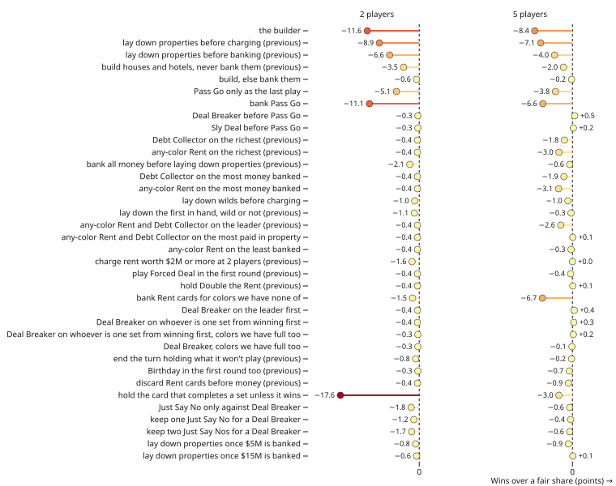

| variant | 2 players (fair 50.0%) | 5 players (fair 20.0%) |
| --- | --- | --- |
| the builder | 38.4% | 11.6% |
| lay down properties before charging (previous) | 41.1% | 12.9% |
| lay down properties before banking (previous) | 43.4% | 16.0% |
| build houses and hotels, never bank them (previous) | 46.5% | 18.0% |
| build, else bank them | 49.4% | 19.8% |
| Pass Go only as the last play | 44.9% | 16.2% |
| bank Pass Go | 38.9% | 13.4% |
| Deal Breaker before Pass Go | 49.7% | 20.5% |
| Sly Deal before Pass Go | 49.7% | 20.2% |
| Debt Collector on the richest (previous) | 49.6% | 18.2% |
| any-color Rent on the richest (previous) | 49.6% | 17.0% |
| bank all money before laying down properties (previous) | 47.9% | 19.4% |
| Debt Collector on the most money banked | 49.6% | 18.1% |
| any-color Rent on the most money banked | 49.6% | 16.9% |
| lay down wilds before charging | 49.0% | 19.0% |
| lay down the first in hand, wild or not (previous) | 48.9% | 19.7% |
| any-color Rent and Debt Collector on the leader (previous) | 49.6% | 17.4% |
| any-color Rent and Debt Collector on the most paid in property | 49.6% | 20.1% |
| any-color Rent on the least banked | 49.6% | 19.7% |
| charge rent worth $2M or more at 2 players (previous) | 48.4% | 20.0% |
| play Forced Deal in the first round (previous) | 49.6% | 19.6% |
| hold Double the Rent (previous) | 49.6% | 20.1% |
| bank Rent cards for colors we have none of | 48.5% | 13.3% |
| Deal Breaker on the leader first | 49.6% | 20.4% |
| Deal Breaker on whoever is one set from winning first | 49.6% | 20.3% |
| Deal Breaker on whoever is one set from winning first, colors we have full too | 49.7% | 20.2% |
| Deal Breaker, colors we have full too | 49.7% | 19.9% |
| end the turn holding what it won't play (previous) | 49.2% | 19.8% |
| Birthday in the first round too (previous) | 49.7% | 19.3% |
| discard Rent cards before money (previous) | 49.6% | 19.1% |
| hold the card that completes a set unless it wins | 32.4% | 17.0% |
| Just Say No only against Deal Breaker | 48.2% | 19.4% |
| keep one Just Say No for a Deal Breaker | 48.8% | 19.6% |
| keep two Just Say Nos for a Deal Breaker | 48.3% | 19.4% |
| lay down properties once $5M is banked | 49.2% | 19.1% |
| lay down properties once $15M is banked | 49.4% | 20.1% |

**Charge before you lay properties down, and bank before that too.** This is the biggest lesson,
worth 9 points at 2 players and 7 at 5. A property laid down can be taken by Sly Deal, Forced Deal
or as payment. One held in hand can't, and it can go down later in a single turn. The default
still lays a property down right away when it completes a set.

**Don't build.** Banking a house ($3M) or hotel ($4M) as money beats putting it on a set. Never
banking them costs 3.1 points at 2 players and 2.0 at 5. Building when you can and banking
otherwise is no better than never building, which is what the default does. A house adds $3M to one rent card's charge, but the play spent placing
it could have charged rent itself. A set with a house is also the first thing a Deal Breaker
takes.

**Charge one player who has to pay in property.** The any-color Rent and Debt Collector hit one
player. Aim them at someone whose bank can't cover the charge but whose table can, since the
properties they pay with come to you. Among those, pick whoever pays the most, then the leader,
the player with the most full sets. Aiming both at the leader instead costs 2.6 points at 5
players, and aiming them at whoever has the most to pay with costs more. At 2 players there's
only one target. At 5 players, playouts at each any-color Rent found this rule gaining 8 points
each time it chose differently from aiming at the leader, more than any other rule tried: the
least banked, the richest, the next or previous seat, the most or fewest cards in hand, and others.

**Don't save Pass Go.** Playing it first, while plays are left to use what it draws, beats holding
it for the last play by 5 points at 2 players. Banking it costs 11.

**Bank about $10M, then lay properties down before banking more.** This beats banking everything
first by 1.7 points at 2 players and 0.6 at 5. $5M is too little, and $15M is about the same as
$10M.

**Charge even $1M at 2 players.** The default used to skip a rent that collected less than $2M.
At 2 players, charging it anyway is worth 1.2 points; at 3 and 4 it costs a little, so the rule
stays there.

**Bank a Forced Deal in the first round at 3+ players, and Double the Rent when there's no rent
to double.** Early on there's little worth swapping, and the money protects the properties you
lay down later. Each gains 0.3 to 0.5 points where it applies (400,000 games). Banking Rent
cards for colors you have none of loses badly: 7 points at 5 players, where those cards charge
everyone.

**Empty your hand when you can, hold Birthday in the first round, and lay down properties
before wilds.** All three came from where a model trained on the dataset (`src/learned.ts`,
`scripts/overrules.ts`) overrules the default. When the plays left can empty the hand, banking
what the default wouldn't play draws 5 cards next turn instead of 2: +0.3 to +0.8 points at 2–5
players. In the first round nobody has much to pay a Birthday with, and holding it gains 0.3 to
0.9 points at 3–5 players (100,000 games each). A wild held in hand can still go wherever it's
needed later; laying down plain properties first gains 0.2 to 0.8 points at 2–5 players
(400,000 games).

**Two pieces of table advice lose.** Players online say to hold the property that completes a
set, so a Deal Breaker can't take the set, and to keep a Just Say No for a Deal Breaker instead
of spending it on rent. Holding the card costs 17 points at 2 players and 3 at 5: a set in hand
charges no rent and counts toward no win. Keeping a Just Say No, even only while holding two,
costs 0.8 to 1.3 points at 2 players and 0.4 to 0.6 at 5. What you lose by paying now is worth more than the Deal Breaker it might stop later.

Tried and rejected, besides the alternatives in the table (at 2 and 5 players, against 49.6% and
20.0% for the default):

- Choosing which property to lay down first, beyond properties before wilds: by the most
  progress toward a set, the least, wilds first, the cheapest or the dearest (by the $M printed
  in its corner), the highest rent or the smallest set. All tie the default or lose (wilds
  first: 47.9% and 19.0%). The dearest first with wilds last ties it.
- Laying down properties before Sly Deal, the model's next most common overrule at 3–5 players:
  47.3% and 17.8%, and 48.7% and 19.4% only in rounds 2–3.
- Laying down a property of a color a Rent card in hand charges, then charging: 49.0% and 19.4%.
- Laying down properties before Debt Collector and Birthday: 45.8% and 15.5%.

**What's left of the placement gap has no pattern.** At 5 players, `decisions.ts` finds playouts
laying a property down before charging rent, Debt Collector or Birthday in some spots, and the
default's choice of rent first or ending the turn winning in others. No rule that splits them
beat the default.

### Paying, saying no and discarding

The default handles these with simple rules: pay from the bank first, say no to anything that
costs it, and discard what it values least. Models trained on playouts of every choice
("A learned player", below) each beat those rules by up to 2 points, but so far none of what they
learned fits in a sentence:

- **Pay mostly from the bank, but not always.** The learned payer wins 50.7%, 35.1%, 26.6% and
  21.6% at 2–5 players against the default's 49.6%, 33.4%, 24.8% and 20.0%. At 5 players it hands
  over a loose property instead of money in about one payment in five, and from the bank it pays
  with fewer, bigger cards, overpaying ($3M for a $2M Birthday). Neither works as a rule: paying
  with a property whenever one covers the charge loses 10 to 26 points, and paying with the
  fewest bank cards only ties the default.
- **Say no to whatever costs you, and counter a No against your own play.** Never countering
  loses 0.1 to 0.3 points, and saving a Just Say No for a Deal Breaker loses (above). Letting a
  Debt Collector through is even. The learned model gains 1.0 to 1.7 points on top.
- **At 3+ players, discard money before Rent cards.** Where the learned discard overrules the
  default (`scripts/overruled.ts`), it most often keeps a Rent card and gives up a $1M or $2M
  bill instead, or at 5 players a loose property or a Pass Go. As a rule, keeping Rent cards over
  money gains 0.3, 0.6 and 0.9 points at 3–5 players (400,000 games) and loses 0.3 at 2, so the
  default now does it at 3+. The learned discard still gains 0.4 to 0.8 points over it.
- **The learned Just Say No's changes don't make rules.** It lets a Debt Collector through and,
  at 5 players, says no to more rent and to Birthday. Saying no to rent of $3M or $4M or more
  instead of $5M, with or without letting Debt Collector through, ties the default or loses up
  to 0.3 points.
- **Keep track of what's been played.** The move model that also counts the Just Say Nos, Deal
  Breakers and other actions still unseen wins up to a point more at 5 players. No rule built on
  that has been tried.

### Against strong opponents

Every table so far plays against default players. *`node scripts/strong.ts`* plays the same
findings against quick playouts in every other seat instead, 8,000 games each (±1.1 points at 2
players, ±0.7 at 5):

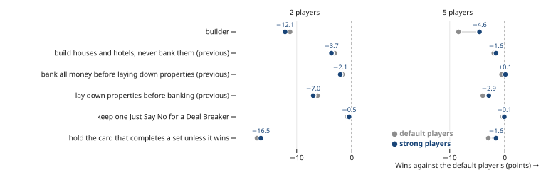

| player | 2 players (fair 50.0%) | 5 players (fair 20.0%) |
| --- | --- | --- |
| default | 46.1% | 13.4% |
| builder | 34.0% | 8.8% |
| build houses and hotels, never bank them (previous) | 42.4% | 11.8% |
| bank all money before laying down properties (previous) | 44.0% | 13.5% |
| lay down properties before banking (previous) | 39.1% | 10.5% |
| keep one Just Say No for a Deal Breaker | 45.6% | 13.3% |
| hold the card that completes a set unless it wins | 29.6% | 11.8% |

**The lessons hold.** Against strong players, building still costs 3.7 points at 2 players and
1.6 at 5, laying properties down before banking costs 7.0 and 2.9, and holding the card that
completes a set costs 17 at 2 players. Keeping a Just Say No for a Deal Breaker is still no
better. Banking all your money first is even at 5 players, as it nearly was before. Gaps shrink
at 5 players, where every player is losing more of their games to the strong ones.

**Going first is worth about the same among strong players.** With quick playouts in every seat,
the first player wins 56.6% at 2 players, against the default's 57.0%, and 23.2% at 5, against
24.2%. The last two seats win 18.6% and 18.1%.

### How good could the choices be?

Playouts still beat the default by 13 to 25 points. What's left at 5 players, found with
playouts that play each deal to the end:

- **Forced Deal.** At 5 players, the best Forced Deal by playouts, rechecked on fresh deals, beats
  the default's by 4.6 points each time they differ, or 1.6 points a game. Most of that is taking
  a different card, often from a different player. But no rule for it beat the default: taking
  from the leader, the dearest card (the most $M in its corner), wilds first, what the victim is
  closest to finishing, giving the cheapest card or what helps the victim least, giving wilds
  too, swapping on a tie, on any swap or only on a clear gain, or playing it before rent. Each
  was scored by playouts at the same decisions. None beat the default beyond the noise, and
  some, like taking the dearest, did worse. Playouts that stop after two rounds find more: at 5 players they play a Forced Deal
  where the default plays something else worth about 7 points a game. But playing it whenever it
  can, before rent, or giving wilds too, each lost up to 0.9 points head to head at 2 and 5
  players (`variants.ts`). Which swap matters, not how often. Picking the swap that most raises
  `chance`, the board score playouts end on, loses too: 47.9% and 19.4% at 2 and 5 players, or
  48.9% and 19.5% only when it raises it. So does picking Sly Deal by it (49.2%, 18.9%). Deal
  Breaker by it ties the default (49.6%, 20.2%).
- **The any-color Rent.** Aiming it at whoever has to pay in property closed most of its gap. The
  best move by playouts now gains at most 2.5 points where they differ, and that's an overstated
  estimate.
- **What to pay with.** `scripts/pay.ts` replays each game to every payment the default makes and
  plays out each way to pay. At 5 players it pays with a loose property instead of money in a
  quarter of payments. Head to head that loses 10 to 26 points: paying with one loose property
  whenever it covers the charge wins 36.0% at 2 players and 10.1% at 5. Playouts want property only in some
  spots, and no rule tried picks them out (`chance` overvaluing the bank isn't why: halving its
  weight changed nothing). Paying from loose properties first, only when the
  bank can't cover the charge, is even.
- **When to Just Say No.** `scripts/sayno.ts` does the same at each chance to say it. Playouts
  would let a Debt Collector through and leave a No against their own action standing, but head
  to head the first is even and never countering a No loses 0.1 to 0.3 points.

### A learned player

Playouts are strong but slow. *`scripts/learn.ts`* turns the dataset (every move of 10,000
default games at each player count, scored by two-round playouts) into 94 numbers per move (106 since card memory, below), and
fits a model that predicts each move's playout score. The learned player then makes the move it
scores highest. It never looks ahead, so a game with one learned player takes about 4 ms of CPU
with the trees and 60 ms with the network.

| player | 2 players (fair 50.0%) | 3 players (fair 33.3%) | 4 players (fair 25.0%) | 5 players (fair 20.0%) |
| --- | --- | --- | --- | --- |
| gradient-boosted trees | 56.0% | 42.0% | 33.8% | 29.1% |
| neural network | 55.5% | 42.6% | 35.2% | 30.7% |
| quick playouts | 53.5% | 40.3% | 36.0% | 33.8% |

100,000 games each against the default in every other seat. The trees (`learn.py`, 1,000 trees,
21 minutes on 20 cores) and the network (`learn_mlx.py`, two layers of 512, 6.5 minutes on the
GPU) are each the first players without lookahead to beat the default, by 6 to 11 points. Both
beat quick playouts at 2 and 3 players. On games they never saw, their picks score 0.5 to 0.6
points of win chance a decision above the default's, and they pick something else 35% to 42% of
the time (the trees) and about 60% (the network).

**Where they overrule the default became three rules.** The model ended its turn by banking a
card the default would hold, when that emptied its hand, and it held Birthday in the first round.
Round 4's model laid down plain properties before wilds. All three are now in the default player.

**As a filter it makes playouts stronger.** Playing out only the trees' top 5 moves, with twice
the shuffles (160), wins 1.3 to 3.1 points more than playing out every move on 80 (59.1%,
48.6%, 43.7% and 38.7%), at 1.2× the time (10,000 games each). That's now `playouts`, with the
trees in `src/packed/model.ts`. Using the model as the player inside the imagined games instead
costs 20× the time and wins less. A network trained to judge the table in place of `chance` is even
on the top 5 with 160 shuffles.

**Training on its own games makes it stronger.** Each round, the learned player plays new games,
its top 6 moves at each decision (and the default's, and one at random) are played out, and new
trees are fit to that round and the one before. Round 0 is the trees above.

| round | 2 players (fair 50.0%) | 3 players (fair 33.3%) | 4 players (fair 25.0%) | 5 players (fair 20.0%) |
| --- | --- | --- | --- | --- |
| 0 | 57.0% | 43.6% | 35.8% | 30.9% |
| 1 | 57.7% | 44.6% | 37.7% | 32.6% |
| 2 | 57.6% | 44.5% | 37.3% | 32.2% |
| 3 | 58.1% | 46.1% | 39.4% | 34.6% |
| 4 | 58.5% | 46.4% | 39.9% | 35.2% |

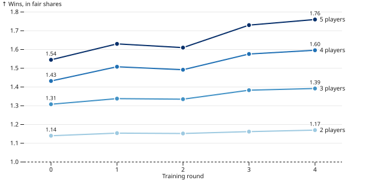

All on the same 50,000 deals against the default in every other seat (`scripts/compare.ts`),
where two rounds differ by ±0.35 to ±0.46 points. Round 1 played 10,000 games a player count,
round 2 2,500, and round 3 5,000 with the playouts paying by the learned payer (`src/packed/pay.ts`).
Round 4 played 10,000 on 16 shuffles a move instead of 32, with only the mover paying that way.
That beat 5,000 games on 32 (+0.1 to +0.3) and 10,000 with half the decisions played out (0 to
+0.6), each against round 3: more decisions beat less noise in each. Ranked playouts gain nothing
from rounds 2 to 4 (±1 to ±1.4 at 4,000 games). Round 6,
with the mover also saying no and discarding by the models below, ties round 4 (+0.1 to +0.6,
±0.3 to ±0.4).

**The other decisions learn the same way.** For paying, Just Say No and discarding, a script
replays default games to every such choice, plays out each way to make it on 32 shuffles, and
trees learn from numbers describing each way (`paying.ts`, `refusing.ts`, `discarding.ts`). Each
beats the default's rule on its own, with the default player's other decisions, against the
default everywhere else (100,000 games; the default itself wins 49.6%, 33.4%, 24.8% and 20.0%):

| learned | 2 players (fair 50.0%) | 3 players (fair 33.3%) | 4 players (fair 25.0%) | 5 players (fair 20.0%) |
| --- | --- | --- | --- | --- |
| paying (`src/packed/pay.ts`) | 50.7% | 35.1% | 26.6% | 21.6% |
| Just Say No (`src/packed/sayno.ts`) | 51.3% | 34.6% | 26.0% | 21.0% |
| discarding (`src/packed/discard.ts`) | 50.1% | 33.8% | 25.6% | 20.7% |

None of them is a rule anyone could write down: the discard model disagrees with the default's
on 82% to 86% of discards at 3 to 5 players. With all three, round 4's trees win 59.6%, 47.5%,
41.6% and 37.1% (100,000 games), 1.5 to 1.9 points more than with the default's. Retraining all
three on playouts where the mover already decides them by the models gains only 0.1 to 0.2.

**Its edge isn't just exploiting the default.** At a table of learned players instead
(`scripts/field.ts`, 100,000 games), the default player wins 39.7%, 21.8%, 13.3% and 9.5%: 10 to
12 points under a fair share, where the learned player is 10 to 17 over one at a table of defaults.

**Remembering what's been played helps a little.** Twelve more numbers, how many of each action
and of the Rent cards the mover hasn't seen in a hand, bank, building or the discard pile, and how
many cards are hidden, gain +0.2, +0.3, +0.3 and +0.4 points over the same data without them
(each ±0.3 to ±0.4, 50,000 deals). Against round 4's trees, +0.3, +0.4, +0.5 and +1.0 (±0.3 to
±0.5), so that model is now `src/packed/model.ts`, for `playouts` and the online game's hard bots.
With the three models above, it wins 59.8%, 47.5%, 41.4% and 36.9% against today's default
(`scripts/learn.ts`, 100,000 games).

**Labels from better players didn't help, yet.** Round 7 played out its moves with the learned
player in every seat instead of the default (`dataset.ts --strong`), 30 to 60 times the cost a
decision, so only 5,000 games a count, half their decisions, on 8 deals. Trained with round 6 it
ties the card-memory model (−0.2 to +0.2); on its own data alone it loses 0.6 to 3.9 points to
round 4, from too few decisions.

**Looking ahead to the end of the turn makes it worse.** Trying the model's top 3 moves, finishing
the turn as the learned player on 8 reshuffles of what it can't see, and keeping the one whose
board `chance` likes best wins 58.5%, 44.0%, 35.4% and 30.3%; the top 5, 56.4%, 39.8%, 30.4% and
25.6% (`scripts/plan.ts`, 20,000 games). The more `chance` gets to choose, the more it overrules
the model, so the board score, not planning itself, is probably what fails.

## What each card is worth

*From `node scripts/cards.ts`*, which deals each game twice: once as dealt, and once with one copy
of a card moved from the draw pile into one player's opening hand. The difference in that player's
wins is the card's value, in points. The noise is about ±0.5 points, and $M is what the card is
worth as money. Sorted by 4 players:

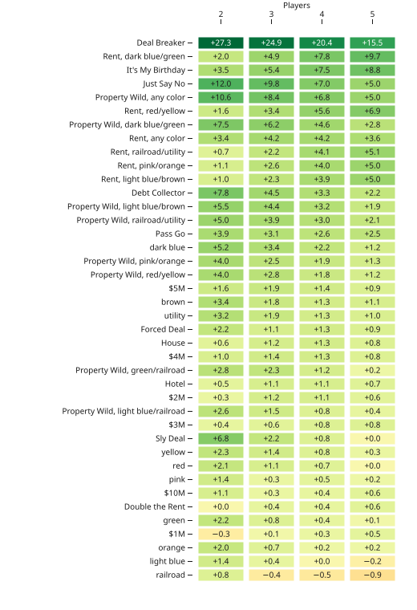

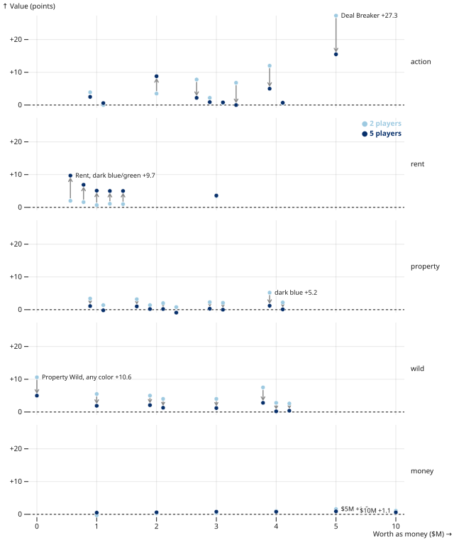

| card | $M | 2 players | 3 players | 4 players | 5 players |
| --- | --- | --- | --- | --- | --- |
| Deal Breaker | 5 | +27.3 | +24.9 | +20.4 | +15.5 |
| Rent, dark blue/green | 1 | +2.0 | +4.9 | +7.8 | +9.7 |
| It's My Birthday | 2 | +3.5 | +5.4 | +7.5 | +8.8 |
| Just Say No | 4 | +12.0 | +9.8 | +7.0 | +5.0 |
| Property Wild, any color | 0 | +10.6 | +8.4 | +6.8 | +5.0 |
| Rent, red/yellow | 1 | +1.6 | +3.4 | +5.6 | +6.9 |
| Property Wild, dark blue/green | 4 | +7.5 | +6.2 | +4.6 | +2.8 |
| Rent, any color | 3 | +3.4 | +4.2 | +4.2 | +3.6 |
| Rent, railroad/utility | 1 | +0.7 | +2.2 | +4.1 | +5.1 |
| Rent, pink/orange | 1 | +1.1 | +2.6 | +4.0 | +5.0 |
| Rent, light blue/brown | 1 | +1.0 | +2.3 | +3.9 | +5.0 |
| Debt Collector | 3 | +7.8 | +4.5 | +3.3 | +2.2 |
| Property Wild, light blue/brown | 1 | +5.5 | +4.4 | +3.2 | +1.9 |
| Property Wild, railroad/utility | 2 | +5.0 | +3.9 | +3.0 | +2.1 |
| Pass Go | 1 | +3.9 | +3.1 | +2.6 | +2.5 |
| dark blue | 4 | +5.2 | +3.4 | +2.2 | +1.2 |
| Property Wild, pink/orange | 2 | +4.0 | +2.5 | +1.9 | +1.3 |
| Property Wild, red/yellow | 3 | +4.0 | +2.8 | +1.8 | +1.2 |
| $5M | 5 | +1.6 | +1.9 | +1.4 | +0.9 |
| brown | 1 | +3.4 | +1.8 | +1.3 | +1.1 |
| utility | 2 | +3.2 | +1.9 | +1.3 | +1.0 |
| Forced Deal | 3 | +2.2 | +1.1 | +1.3 | +0.9 |
| House | 3 | +0.6 | +1.2 | +1.3 | +0.8 |
| $4M | 4 | +1.0 | +1.4 | +1.3 | +0.8 |
| Property Wild, green/railroad | 4 | +2.8 | +2.3 | +1.2 | +0.2 |
| Hotel | 4 | +0.5 | +1.1 | +1.1 | +0.7 |
| $2M | 2 | +0.3 | +1.2 | +1.1 | +0.6 |
| Property Wild, light blue/railroad | 4 | +2.6 | +1.5 | +0.8 | +0.4 |
| $3M | 3 | +0.4 | +0.6 | +0.8 | +0.8 |
| Sly Deal | 3 | +6.8 | +2.2 | +0.8 | +0.0 |
| yellow | 3 | +2.3 | +1.4 | +0.8 | +0.3 |
| red | 3 | +2.1 | +1.1 | +0.7 | +0.0 |
| pink | 2 | +1.4 | +0.3 | +0.5 | +0.2 |
| $10M | 10 | +1.1 | +0.3 | +0.4 | +0.6 |
| Double the Rent | 1 | −0.0 | +0.4 | +0.4 | +0.6 |
| green | 4 | +2.2 | +0.8 | +0.4 | +0.1 |
| $1M | 1 | −0.3 | +0.1 | +0.3 | +0.5 |
| orange | 2 | +2.0 | +0.7 | +0.2 | +0.2 |
| light blue | 1 | +1.4 | +0.4 | −0.0 | −0.2 |
| railroad | 2 | +0.8 | −0.4 | −0.5 | −0.9 |

**Deal Breaker is worth the most by far.** With it, a 2-player game goes from a coin flip to 77%
for the holder. It's a third of a win, taken from someone else.

**Two-color Rent cards gain value with more players**, from +1 to +2 at 2 players to +5 to +10 at
5. Each one charges every other player, so it collects more the more players there are. The one
for the most expensive colors, dark blue and green, is the second most valuable card at 4 and 5
players, after Deal Breaker. Yet each is worth just $1M as money.

**Cards that hit one player lose value with more players.** Just Say No, Debt Collector and Sly
Deal are each worth far more at 2 players, where the one player they hit is the only opponent.

**Money is worth little**, never more than 1.9 points, and $10M is worth barely more than $1M. One
more card of money mostly sits in the bank as insurance against rent.

**The two multicolored Property Wilds are worth nothing as money, but they're among the most
valuable cards** at 2 and 3 players. They fit any set.

**Of the properties, dark blue, brown and utility are worth most.** They're the 2-card sets. Light
blue, pink and railroad are worth least.

A card worth nothing or less, like a railroad or light blue at 5 players, shows where the
default player misplays it, not that you'd be better off without it.

### Played or banked

The same deals again, with the extra action or Rent card banked on the player's first play
instead. Each cell is the card's value banked, then (in parentheses) played as the default plays
it:

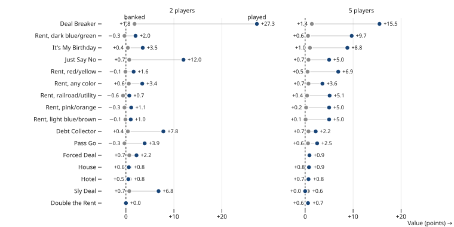

| card | $M | 2 players | 3 players | 4 players | 5 players |
| --- | --- | --- | --- | --- | --- |
| Deal Breaker | 5 | +1.8 (+27.3) | +2.0 (+24.9) | +1.8 (+20.4) | +1.4 (+15.5) |
| Rent, dark blue/green | 1 | −0.3 (+2.0) | +0.4 (+4.9) | +0.1 (+7.8) | +0.6 (+9.7) |
| It's My Birthday | 2 | +0.4 (+3.5) | +1.1 (+5.4) | +1.0 (+7.5) | +1.0 (+8.8) |
| Just Say No | 4 | +0.7 (+12.0) | +1.4 (+9.8) | +1.1 (+7.0) | +0.7 (+5.0) |
| Rent, red/yellow | 1 | −0.1 (+1.6) | +0.2 (+3.4) | +0.7 (+5.6) | +0.5 (+6.9) |
| Rent, any color | 3 | +0.6 (+3.4) | +1.1 (+4.2) | +0.8 (+4.2) | +0.7 (+3.6) |
| Rent, railroad/utility | 1 | −0.6 (+0.7) | +0.5 (+2.2) | +0.5 (+4.1) | +0.4 (+5.1) |
| Rent, pink/orange | 1 | −0.3 (+1.1) | +0.6 (+2.6) | +0.4 (+4.0) | +0.2 (+5.0) |
| Rent, light blue/brown | 1 | −0.1 (+1.0) | +0.1 (+2.3) | +0.7 (+3.9) | +0.1 (+5.0) |
| Debt Collector | 3 | +0.4 (+7.8) | +0.8 (+4.5) | +1.0 (+3.3) | +0.7 (+2.2) |
| Pass Go | 1 | −0.3 (+3.9) | +0.7 (+3.1) | +0.8 (+2.6) | +0.6 (+2.5) |
| Forced Deal | 3 | +0.7 (+2.2) | +1.1 (+1.1) | +1.3 (+1.3) | +0.9 (+0.9) |
| House | 3 | +0.8 (+0.6) | +1.3 (+1.2) | +1.2 (+1.3) | +0.9 (+0.8) |
| Hotel | 4 | +0.8 (+0.5) | +1.1 (+1.1) | +1.1 (+1.1) | +0.8 (+0.7) |
| Sly Deal | 3 | +0.7 (+6.8) | +1.1 (+2.2) | +1.2 (+0.8) | +0.6 (+0.0) |
| Double the Rent | 1 | +0.0 (−0.0) | +0.1 (+0.4) | +0.3 (+0.4) | +0.7 (+0.6) |

**Play your action cards; don't bank them.** Banked on the first play, none is worth more than
2.0 points, about what money is. Played, Deal Breaker is worth ten times that, and most Rent
cards several times. A Rent card's $1M is the least of it.

**Except Forced Deal and Double the Rent, early.** Forced Deal was worth more banked on the first
play than as the default played it at 3 or more players, so the default now banks it in the first
round there, and Double the Rent whenever there's no rent to double: the two columns now match.
Banking every Forced Deal still loses, 1.3 points at 5 players and 2.8 at 2 (`variants.ts`). Sly
Deal at 4 and 5 players is worth a little more banked too, but banking every Sly Deal loses 2.7
to 7 points.

Houses and hotels come out the same either way: the default banks them already.

## Which colors to chase

*From `node scripts/colors.ts`*, which counts, at the end of each game, the colors of the winner's
full sets and of the losers'. A winner has exactly 3 sets, so the shares in a column add up to
300%. The winner's share comes first, then in parentheses how often a loser holds that color as a
full set at the end.

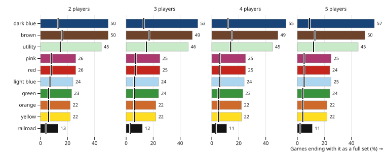

| color | cards in a set | 2 players | 3 players | 4 players | 5 players |
| --- | --- | --- | --- | --- | --- |
| dark blue | 2 | 50% (13%) | 53% (13%) | 55% (12%) | 57% (9%) |
| brown | 2 | 50% (16%) | 49% (17%) | 49% (15%) | 50% (13%) |
| utility | 2 | 45% (15%) | 46% (15%) | 45% (14%) | 45% (12%) |
| pink | 3 | 26% (8%) | 25% (7%) | 25% (6%) | 25% (5%) |
| red | 3 | 26% (8%) | 25% (7%) | 25% (6%) | 24% (5%) |
| light blue | 3 | 24% (7%) | 24% (6%) | 24% (6%) | 25% (5%) |
| green | 3 | 23% (6%) | 24% (6%) | 23% (5%) | 24% (4%) |
| orange | 3 | 22% (6%) | 22% (6%) | 22% (5%) | 22% (4%) |
| yellow | 3 | 22% (6%) | 22% (6%) | 22% (5%) | 22% (4%) |
| railroad | 4 | 13% (4%) | 12% (3%) | 11% (3%) | 11% (2%) |

**Each 2-card set, dark blue, brown and utility, is in about half of all wins.** That's about twice
as often as any 3-card set.

**Railroads, the one 4-card set, are in only one win in eight.**

**Dark blue rises to 57% at 5 players.** It's a 2-card set and charges the highest rent, 8. So
it's the set most worth finishing, and the one most worth taking with a Deal Breaker.

So: chase 2-card sets, especially dark blue, and leave railroads for last. The default player only
places what it draws, so these shares follow from how easy each set is to finish, not from any
plan.

## When a game is decided

*From `node scripts/decided.ts`*, which plays default players and, after each round, finds who's
ahead by the chance to win that playouts score boards with: full sets, progress toward more,
money and cards in hand. Each cell is the share of games still going, then how often the player
ahead wins them, and in parentheses how often the one furthest behind does. 100,000 games each.

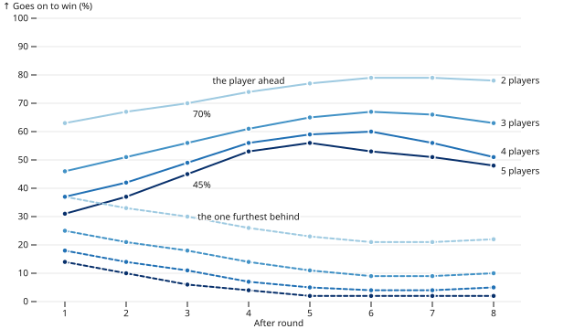

| after round | 2 players | 3 players | 4 players | 5 players |
| --- | --- | --- | --- | --- |
| 1 | 100%: 63% (37%) | 100%: 46% (25%) | 100%: 37% (18%) | 100%: 31% (14%) |
| 2 | 100%: 67% (33%) | 100%: 51% (21%) | 100%: 42% (14%) | 100%: 37% (10%) |
| 3 | 100%: 70% (30%) | 100%: 56% (18%) | 100%: 49% (11%) | 99%: 45% (6%) |
| 4 | 99%: 74% (26%) | 98%: 61% (14%) | 96%: 56% (7%) | 93%: 53% (4%) |
| 5 | 96%: 77% (23%) | 91%: 65% (11%) | 83%: 59% (5%) | 73%: 56% (2%) |
| 6 | 86%: 79% (21%) | 74%: 67% (9%) | 58%: 60% (4%) | 41%: 53% (2%) |
| 7 | 70%: 79% (21%) | 49%: 66% (9%) | 30%: 56% (4%) | 13%: 51% (2%) |
| 8 | 49%: 78% (22%) | 25%: 63% (10%) | 9%: 51% (5%) | 3%: 48% (2%) |

**Nothing is decided early.** After three rounds the player ahead wins 70% of 2-player games and
45% at 5, where a fair share is 20%. Whoever is furthest behind still wins 30% at 2 players and
6% at 5.

**Comebacks run out at big tables.** At 2 players, the player behind after round 5 still wins
one game in five, as often as after round 8. At 5 players it's 2%: four others can take from
the leader, but the last player rarely catches all of them.

**The lead stops growing after round 5 or so.** Games still going then are the close ones, so
being ahead says less. At 5 players three games in five are over by round 6.

## Paying

*From `node scripts/payments.ts`*, every payment in 100,000 games of default players each:

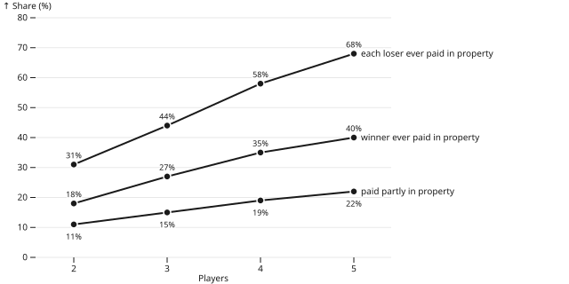

| | 2 players | 3 players | 4 players | 5 players |
| --- | --- | --- | --- | --- |
| payments a game | 7.6 | 17.2 | 29.1 | 43.6 |
| bank when charged | $11.0M | $10.1M | $9.2M | $8.7M |
| paid partly in property | 11% | 15% | 19% | 22% |
| property paid a game | $2.6M | $8.2M | $17.7M | $30.4M |
| winner ever paid in property | 18% | 27% | 35% | 40% |
| each loser ever paid in property | 31% | 44% | 58% | 68% |

**Big tables are expensive.** Two-color Rent cards and Birthday charge everyone, so at 5 players
there are more than five times as many payments as at 2, and $30.4M of property changes hands a
game.

**The bank runs dry with more players.** The default banks about $10M before laying properties
down, and at 2 players that's what it has when charged. At 5 it's $8.7M, and one payment in five
costs property. Most losers at 5 players pay in property at least once, and so do 40% of winners:
paying in property hurts, but it doesn't decide the game. How to pay well is under "Paying,
saying no and discarding".

## Opening hands

*From `node scripts/openings.ts`*, each player's wins in 100,000 games of default players, by
what its 5 opening cards were. Each cell is wins in fair shares (1.00 is a fair share), then (in
parentheses) how many hands that was. Rent cards count as actions and wilds as properties.

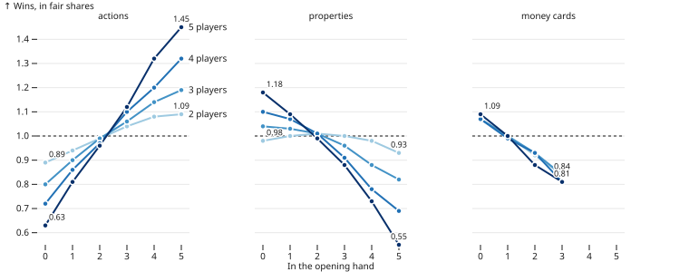

| actions | 2 players | 3 players | 4 players | 5 players |
| --- | --- | --- | --- | --- |
| 0 | 0.89 (5%) | 0.80 (5%) | 0.72 (5%) | 0.63 (5%) |
| 1 | 0.94 (21%) | 0.90 (21%) | 0.86 (21%) | 0.81 (21%) |
| 2 | 0.99 (35%) | 0.99 (35%) | 0.97 (35%) | 0.96 (35%) |
| 3 | 1.04 (27%) | 1.06 (27%) | 1.10 (27%) | 1.12 (27%) |
| 4 | 1.08 (10%) | 1.14 (10%) | 1.20 (10%) | 1.32 (10%) |
| 5 | 1.09 (1%) | 1.19 (1%) | 1.32 (2%) | 1.45 (2%) |

| properties | 2 players | 3 players | 4 players | 5 players |
| --- | --- | --- | --- | --- |
| 0 | 0.98 (9%) | 1.04 (9%) | 1.10 (10%) | 1.18 (9%) |
| 1 | 1.00 (30%) | 1.03 (29%) | 1.07 (29%) | 1.09 (30%) |
| 2 | 1.01 (35%) | 1.01 (35%) | 1.01 (35%) | 0.99 (35%) |
| 3 | 1.00 (20%) | 0.96 (20%) | 0.91 (20%) | 0.88 (20%) |
| 4 | 0.98 (6%) | 0.88 (5%) | 0.78 (6%) | 0.73 (5%) |
| 5 | 0.93 (1%) | 0.82 (1%) | 0.69 (1%) | 0.55 (1%) |

| money cards | 2 players | 3 players | 4 players | 5 players |
| --- | --- | --- | --- | --- |
| 0 | 1.07 (34%) | 1.07 (34%) | 1.07 (34%) | 1.09 (34%) |
| 1 | 1.00 (42%) | 1.00 (42%) | 0.99 (42%) | 1.00 (42%) |
| 2 | 0.92 (19%) | 0.93 (19%) | 0.93 (19%) | 0.88 (19%) |
| 3 | 0.84 (4%) | 0.84 (4%) | 0.81 (4%) | 0.81 (4%) |

**Action cards make a hand.** A hand of four or five action cards wins 1.1 to 1.5 fair shares,
and one with none 0.63 to 0.89. Properties and money are the weak cards to open with.

**The opening hand matters more at big tables.** At 2 players every hand is within 16% of a fair
share; at 5, the best and worst are more than twice apart.

## Rules questions

The rule sheet leaves some rules open, and Hasbro publishes no FAQ to settle them. Fan sites
disagree, and they rarely cite a source. So the engine reads each one way (see `CLAUDE.md`), and
*`node scripts/sensitivity.ts`* plays 100,000 games each way from the same seeds, for each player
count. Each row names the other reading. Each cell gives the share of games whose winner changes,
then the change in the first player's share of wins in points, then the change in turns per game,
then any change in the number of stalled games:

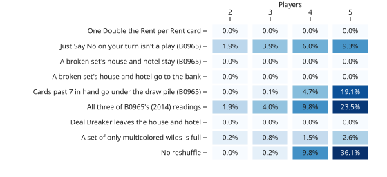

| reading | 2 players | 3 players | 4 players | 5 players |
| --- | --- | --- | --- | --- |
| One Double the Rent per Rent card | 0.0%: +0.0, +0.0 | 0.0%: +0.0, +0.0 | 0.0%: +0.0, +0.0 | 0.0%: +0.0, +0.0 |
| Just Say No on your turn isn't a play (B0965) | 1.9%: +0.1, +0.0 | 3.9%: +0.0, −0.1 | 6.0%: +0.0, −0.1 | 9.3%: +0.1, −0.2, −1 stalled |
| A broken set's house and hotel stay (B0965) | 0.0%: +0.0, +0.0 | 0.0%: +0.0, +0.0 | 0.0%: +0.0, +0.0 | 0.0%: +0.0, +0.0 |
| A broken set's house and hotel go to the bank | 0.0%: +0.0, +0.0 | 0.0%: +0.0, +0.0 | 0.0%: +0.0, +0.0 | 0.0%: +0.0, +0.0 |
| Cards past 7 in hand go under the draw pile (B0965) | 0.0%: +0.0, +0.0 | 0.1%: +0.0, +0.0 | 4.7%: +0.2, +0.0 | 19.1%: −0.5, +0.1, −1 stalled |
| All three of B0965's (2014) readings | 1.9%: +0.1, +0.0 | 4.0%: +0.0, −0.1 | 9.8%: +0.1, −0.1 | 23.5%: −0.4, −0.1, −1 stalled |
| Deal Breaker leaves the house and hotel | 0.0%: +0.0, +0.0 | 0.0%: +0.0, +0.0 | 0.0%: +0.0, +0.0 | 0.0%: +0.0, +0.0 |
| A set of only multicolored wilds is full | 0.2%: +0.0, +0.0 | 0.8%: +0.0, +0.0 | 1.5%: +0.0, +0.0 | 2.6%: +0.1, +0.0 |
| No reshuffle | 0.0%: +0.0, +0.0 | 0.2%: +0.0, +0.2, +116 stalled | 9.8%: −2.1, +12.0, +7203 stalled | 36.1%: −8.0, +48.1, +29097 stalled |

Once a reading changes one play, the rest of the game goes differently, and the winner then
changes about as often as in an unrelated game. So the first number tracks how often the rule
comes up at all.

**None of the readings favors a seat.** That's expected when every player plays the same way. The
one exception is the reshuffle, which changes how long games last.

**The 2014 sheet's readings come up in up to 24% of games at 5 players, and lean nowhere.**
Together they move the first player's share by 0.4 points at most and games by 0.1 turns. Just Say No as a play only bites when you
counter a No on your own turn after using all three plays. Discarding past 7 keeps those cards
out of the draw until the next reshuffle, so it comes up mostly at 4 and 5 players, where the
draw pile runs out.

**The three readings about houses and hotels never come up,** because the default player never
builds. They'd matter only for a player that does.

**Wild-only sets come up in 0–3% of games, and Double the Rent stacking almost never.** There are
only 2 multicolored wilds and 2 Double the Rents in the deck, and the default banks a Double the
Rent when there's no rent to double.

**No reshuffle breaks 4- and 5-player games.** At 5 players the draw pile runs out in nearly half
of games. Without a reshuffle, nearly a third of games end with no winner after 200 turns.
Neither sheet says what happens then, so reshuffling is our house rule.

## Stalled games

**A game stalls when the cards run out of circulation.** In every stalled game we looked at, the
draw pile and the discard pile are both empty, and all 106 cards are in banks, on tables or in
hands. A banked card never comes back, and a full bank holds many action cards. With nothing to
draw, the cards left in hand can't finish anyone's third set, and the game never ends.

**Players who bank their action cards cause it.** Default players alone stalled once in 800,000
games (`sim.ts` and `strategies.ts`). One pacifist, which banks every action card, stalls 19
games in 100,000 at 4 players and 64 at 5. Without the reshuffle the draw pile empties for good, and nearly a third of 5-player
games stall ("Rules questions").

**A player out to stall the game would, untested:**

- bank every money and action card, and never play an action, since played ones are reshuffled
  back in;
- lay properties down without completing sets, since properties can't be banked;
- spend Just Say No on any steal that would complete someone's set, and pay with money before
  property, never with a property that finishes someone's set;
- play at 5 players, where the draw pile already runs out in nearly half of games.

## Next

`TODO.md` has what's left: closing more of the gap to playouts, turning what the learned models
know about paying, saying no and discarding into advice, and comparing the model with real games
from the online version at monopoly.visnup.com.
